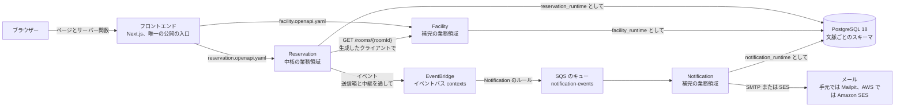
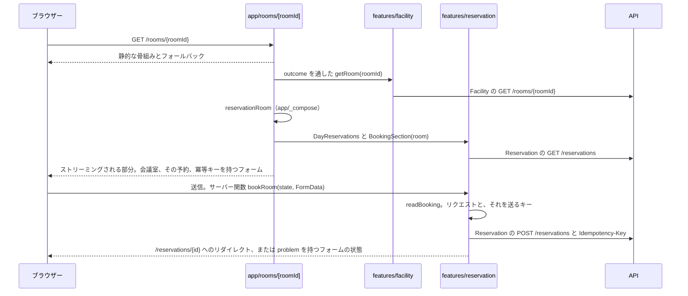
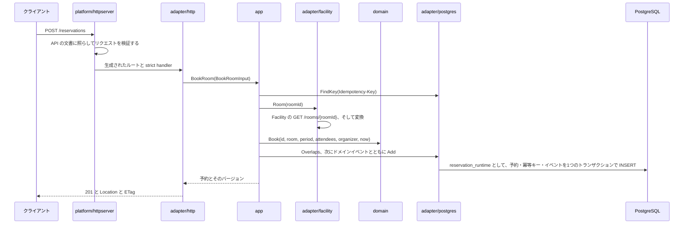
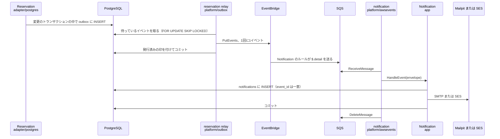
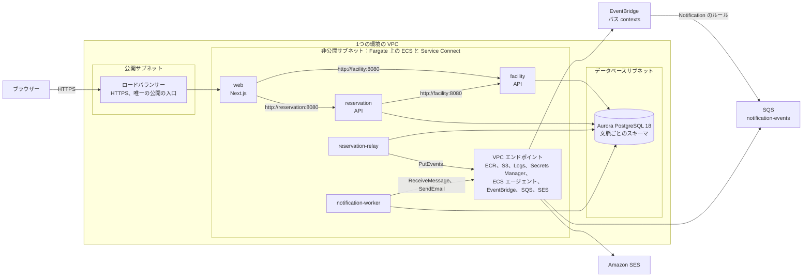

# アーキテクチャ

製品の地図である。区切られた文脈とそのプロセス、文脈の中の層、それらを見せるフロントエンド、画面から API を通るリクエストの流れ、イベントの流れ、データベース、AWS の環境、そして構成を保つチェックを示す。
理由は決定の記録（[docs/adr/](docs/adr/README.ja.md)）に、手順はガイド（[docs/guides/](docs/guides/)）にある。

## 区切られた文脈



| 文脈 | 種類 | 受け持つもの | 契約 |
|---|---|---|---|
| [Facility](docs/contexts/facility/README.ja.md) | 補完 | 会議室。その名前・定員・利用時間・タイムゾーン | API：`contracts/http/facility.openapi.yaml` |
| [Reservation](docs/contexts/reservation/README.ja.md) | 中核 | 会議室の予約・変更・取り消し。予約が重ならないようにする | API：`contracts/http/reservation.openapi.yaml`。発行するイベント：`contracts/events/reservation.asyncapi.yaml` |
| [Notification](docs/contexts/notification/README.ja.md) | 補完 | 予約が確定したときと取り消されたときの、主催者へのメール | API はない。受け取るイベント：`contracts/events/notification.asyncapi.yaml` |

- 各文脈は、`backend/cmd/<context>` から自分のイメージにビルドする。文脈どうしが共有するコードは `backend/internal/platform/` だけで、データは共有しない。どの文脈も、見えるのは自分のスキーマだけである。
- Reservation は、予約のたびに会議室の定員・利用時間・タイムゾーンを必要とする。そこで、Facility の API の文書から oapi-codegen が生成したクライアントを使い、HTTP で Facility に問い合わせる。答えはアダプター `adapter/facility` が Reservation 自身の `domain.Room` に変換するので、Facility の型がユースケースやドメインに届くことはない（TPL-0005）。Facility が失敗したとき、または3秒以内に答えないとき、予約はステータス 503 と `Retry-After` ヘッダーで失敗する。
- Reservation は、統合イベントで Notification に予約のことを知らせる（TPL-0013）。Reservation は、Notification があることを知らない。予約からメールまでのイベントの道のりは、[イベントの流れ](#イベントの流れ)で追う。
- Notification には API がない。自分のキューから自分宛てのイベントを読んでメールを送る、ワーカーである。
- `frontend/` のフロントエンドは文脈ではない。Facility と Reservation を、それぞれに1つの機能を割り当てて画面に見せる。それらの API を呼ぶのはフロントエンドのサーバーだけである（TPL-0014）。詳しくは[フロントエンド](#フロントエンド)で述べる。

## プロセス

文脈の各プロセスは、その文脈のイメージから、文脈のコマンドかそのモードの1つで動く（TPL-0014）。フロントエンドは専用のイメージから動く。

| 文脈 | プロセス | コマンド | `compose.yaml` のサービス | AWS の ECS のサービス |
|---|---|---|---|---|
| Facility | API | `facility` | `facility` | `facility` |
| Reservation | API | `reservation` | `reservation` | `reservation` |
| Reservation | 送信箱の中継（ワーカー） | `reservation relay` | `reservation-relay` | `reservation-relay` |
| Notification | キューからイベントを受け取る側（ワーカー） | `notification` | `notification` | `notification-worker` |
| （なし） | フロントエンド。Next.js のサーバー | standalone のサーバー `frontend/server.js` を Node で動かす | `web` | `web` |

- `platform/httpserver.Main` は、文脈のコマンドか、引数で名前を指定したモード（`httpserver.Mode`）か、ヘルスチェック（`<command> healthcheck`）を動かす。コマンドは設定を環境変数から読み、その変数の一覧は `backend/cmd/<context>/main.go` の先頭のコメントにある。
- API は `platform/httpserver.Run` の上で動く。ワーカーは `platform/httpserver.RunWorker` の上で動き、仕事と並んで `GET /healthz` に答える。そのため、イメージのヘルスチェックは、API もワーカーも同じ方法で見張れる。ワーカーのヘルスチェックが示すのは、プロセスが動いていることだけである。データベースやブローカーに届かないワーカーは、正常のまま失敗をログに書き、試し直す。
- 中継とワーカーは、`platform/awsconfig` で AWS SDK の設定を読む。設定はリージョンと、手元では AWS Emulator のエンドポイントとその CA である（TPL-0017）。AWS では、SDK はいつもの名前で各サービスに届き、その名前は VPC エンドポイントに解決される。
- フロントエンドのイメージは `frontend/Dockerfile` がビルドする。中身は、`next build` の standalone の出力を distroless の Node に載せたものである。サーバーは、各 API のベース URL を `FACILITY_API_URL` と `RESERVATION_API_URL` から読む。そのヘルスチェック `GET /healthz` は 200 を返し、API を呼ばない。そのため、止まっている文脈があってもフロントエンドは再起動されない。イメージにシェルがないので、このチェックは Node が実行する（`healthcheck.mjs`）。

## 文脈の中の層

業務領域の種類が層を決める（TPL-0003、TPL-0004）。

```text
backend/internal/reservation/    中核：ポートとアダプターを備えたドメインモデル
├── module.go                    アダプター・ユースケース・ハンドラーと、中継（NewRelay）を組み立てる。import するのは cmd/reservation だけ
└── internal/
    ├── domain/                  集約 Reservation と、その決まり・ドメインイベント・業務エラー。I/O をしない
    ├── app/                     ユースケース（1つにつき1ファイル）、ポート、ユースケースのエラー
    └── adapter/
        ├── http/                生成された strict server の操作の実装と、エラーから problem への対応表
        ├── postgres/            schema.sql、queries/、sqlc の生成コード、その上の Store、ドメインイベントから
        │                        統合イベントへの詰め替え（events.go）、送信箱（outbox.go）
        └── facility/            Facility の API の文書から生成したクライアントと、その上の RoomDirectory

backend/internal/facility/       補完：トランザクションスクリプト
├── module.go
└── internal/
    ├── app/                     生成したクエリを呼ぶユースケースと、業務エラー
    └── adapter/
        ├── http/
        └── postgres/            schema.sql、queries/、sqlc の生成コード

backend/internal/notification/   補完、ワーカー：トランザクションスクリプト
├── module.go                    NewHandler が文脈の event.Handler を返す
└── internal/
    ├── app/                     ユースケース Notifier、イベントのためのモデル変換装置（events.go）、ポート Mailer
    └── adapter/
        ├── postgres/            schema.sql、queries/、sqlc の生成コード
        ├── smtp/                SMTP で送る Mailer。手元の環境で Mailpit に送る
        └── ses/                 Amazon SES で送る Mailer。AWS で使う
```

Reservation は、この製品が存在する理由である決まりを持ち、それらの決まりは互いに依存する。
会議室のタイムゾーンによって時間帯がどの日に属するかが決まり、その日によって利用時間が決まる。重なりは、同時に届いた2つのリクエストの間でも起こりうる。
これらの決まりは `domain` に置く。`domain` は現在時刻と新しい ID を引数で受け取るので、決まりのテストは素の関数呼び出しで済む。
`app` のユースケースは、ドメインが必要とするものをポート（`Store`・`RoomDirectory`・`Clock`・`IDGenerator`）を通して読み込む。`module.go` が、そのポートにアダプターをつなぐ。

Facility が確かめる決まりは、会議室が閉まるより前に開くことと、そのタイムゾーンが存在することの2つだけで、あとは行を保存する。
ドメイン層と、ドメイン層と行の間の詰め替えは、これらの決まりより高くつく。そこでユースケースは sqlc が生成した `Querier` を呼び、行を `app` の型へ直接詰め替える。

Notification に固有の決まりは、イベント1つにつきメールを1回だけ送ることの1つだけなので、Facility と同じくトランザクションスクリプトで書く。
そのユースケースを呼ぶのは API の操作ではなく、キューからイベントを受け取る側であり、`NewHandler` が返す `event.Handler` を通して呼ぶ。メールはポート `Mailer` を通して送るので、テストでは `app/apptest/` の偽物を使う。コマンドは、環境変数からアダプターを選ぶ。手元のシステムのように `SMTP_ADDR` が設定されていれば `adapter/smtp` を、AWS のように設定されていなければ `adapter/ses` を使う。

`lint-arch` は、ディレクトリ `internal/domain/` があるかどうかで2つの種類を見分ける。`app` が自分の `adapter/postgres` を import してよいのは、このディレクトリのない文脈だけである。

## フロントエンド

`frontend/` は、App Router を使う Next.js 16 のアプリで、React 19 と TypeScript 6 で書く（TPL-0002）。
ブラウザーは、このアプリとだけ通信する。アプリのサーバーは、ページを描き、フォームのサーバー関数を実行し、非公開のネットワークにある文脈の API を呼ぶ。呼び出しには、API の文書が型を付けたクライアントを使う（TPL-0006、TPL-0014）。そのため、どの API にも CORS は要らず、API のアドレスがブラウザーに届くこともない。

```text
frontend/src/
├── app/                         ルート。各ページは機能を組み合わせ、リクエストのたびにデータを読む部分を <Suspense> で包む
│   ├── page.tsx                 会議室の一覧（Facility）
│   ├── rooms/new/               会議室を登録するフォーム（Facility）
│   ├── rooms/[roomId]/          会議室（Facility）と、その1日分の予約と、予約するフォーム（Reservation）
│   ├── reservations/[reservationId]/
│   │                            予約（Reservation）とその会議室（Facility）と、予約を変えるフォーム
│   ├── healthz/                 ヘルスチェック
│   └── _compose/                ある文脈が渡すものを、別の文脈が必要とする形にする変換。Facility の会議室を
│                                Reservation の Room にする
├── features/<context>/          区切られた文脈ごとの機能。機能はほかの機能を import しない
│   ├── server/                  outcome を通した、その文脈の API の呼び出し。server-only
│   ├── actions.ts               フォームのサーバー関数
│   ├── <name>.ts                純粋なロジック（フォームの読み取り、problem の種類ごとの文言など）。
│   │                            その単体テストは <name>.test.ts
│   └── components/              サーバーコンポーネントと、クライアントコンポーネントとしてのフォーム
└── lib/
    ├── api/                     <context>.gen.ts。各 API の文書から openapi-typescript が生成する型
    ├── api/server/              API のクライアント（openapi-fetch）と outcome。server-only
    ├── problem.ts               problem。その種類と、フォームの項目へのメッセージ
    ├── input.ts、zoned-time.ts  フォームの値。タイムゾーンの中の日付と時刻
    └── components/              Field、ProblemNotice、useFocusOnProblem
```

- ページは既定で静的であり、文脈のデータを読む部分は、それぞれ `<Suspense>` の内側であとからストリーミングされる（Cache Components）。`outcome` はリクエストを待つ（`connection()`）ので、ビルドのデータが静的なページに入ることはない。
- API の呼び出しは、どれも `Result` になる。答えの値か、problem である。答えない API や、problem でないもので答える API も problem になるので、画面はどの失敗も同じ方法で表示する。
- 画面は、`problemKind`（`docs/problems/` にある problem のページの名前）で文言を選び、リクエストの不正な部分をそれぞれの項目に表示する（`fieldErrors`）。title や detail は解析しない（TPL-0008）。
- フォームは API の決まりに従う。予約は、フォームを描くときにサーバーが作る冪等キーを送る。フォームは、そのキーと、そのキーで送った予約のフィンガープリントを持ち続ける。そのため、同じ予約をもう一度送っても予約は1回だけで、同じフォームから別の予約を送ると新しいキーになる（`features/reservation/booking.ts`）。変更は、ページが表示したバージョンを `If-Match` で送り、バージョンのない変更は送らない。412 のときは、ページがメッセージと予約の今の状態を表示する。
- 人は、会議室のタイムゾーンで時刻を読み、入力する。`lib/zoned-time.ts` が `Intl.DateTimeFormat` で、それと API の日時とを相互に変換する。日付のライブラリは使わない。`Temporal` も使わない。いまのブラウザーのすべてにあるわけではないからである。
- CSS は素の CSS で、コンポーネントライブラリは使わず、サインインもない。デザインシステムと認証は、テンプレートをコピーしたチームに任せる。

## 画面からのリクエストの流れ

会議室のページは、会議室とその予約を表示する。人は、そのページのフォームで会議室を予約する。



1. Next.js は、ページの静的な骨組みをすぐに送る。レイアウト、リンク、各 `<Suspense>` のフォールバックである。その内側の部分はサーバーで描かれ、データがそろうとストリーミングされる。
2. ページは、facility の機能を通して会議室を読み、`app/_compose/` でそれを Reservation の `Room` に変え、reservation の機能のコンポーネントに渡す。2つの機能が互いを import することはない。
3. 各サーバーのモジュールは、`outcome` を通して API を呼び、`Result` を得る。呼び出しには `lib/api/server/clients.ts` の型付きのクライアントを使い、5秒でタイムアウトさせる。各 API のベース URL は環境変数から来る。
4. フォームは、そのサーバー関数に POST する。サーバー関数には誰でも POST できる。サーバー関数は、フォームの各値を絞り込み、API を呼ぶ。そのあと、次のページへ移るか（`redirect`）、ページを読み直すか（`refresh`）、フォームが表示する状態を返す。状態は、入力された値、各項目へのメッセージ、フォーム全体へのメッセージである。
5. 各 API の中では、リクエストは次の節の流れをたどる。

## リクエストの流れ

Reservation の API では、`POST /reservations` が会議室を予約する。



1. `cmd/reservation` は、設定を環境変数から読み（`platform/config`）、接続プールを開く（`platform/postgres`）。そして、`module.go` が組み立てたハンドラーを動かす（`platform/httpserver.Run`）。
2. `platform/httpserver.NewHandler` は、すべてのリクエストをアクセスログと panic からの回復で包み、ヘルスチェック `GET /healthz` には自分で答える。ほかのリクエストはすべて kin-openapi で API の文書に照らして検証する。文書が許さないリクエストには、文脈のコードが動く前に problem で答える。
3. `adapter/http/api.gen.go` の生成コードは、`http.ServeMux` の上でリクエストを振り分け、パラメーターと本文をデコードして生成された型に入れ、`adapter/http/handler.go` の操作を呼ぶ。操作はそれらの型をユースケースの入力に詰め替えるだけで、ほかのことはしない。
4. `app` のユースケース `BookRoom` は、まず冪等キーを調べる。次に、ポート `RoomDirectory` から会議室を、`IDGenerator` から新しい ID を、`Clock` から時刻を得る。最後に `domain.Book` を呼ぶ。`domain.Book` は決まりを適用し、予約とそのドメインイベント `ReservationConfirmed` を返す。
5. `adapter/postgres` の `Store` は、sqlc が `queries/*.sql` から生成したクエリで、予約とその冪等キーとイベントを1つのトランザクションの中で保存する。その間にほかのリクエストが重なる予約を保存していれば、`schema.sql` の排他制約がこれを拒み、イベントも保存されない。
6. 戻りでは、`adapter/http/problems.go` が `domain` や `app` の業務エラーを対応する problem に変える。それを `platform/httpserver.ResponseError` が `application/problem+json` として書く。そのほかのエラーはログに書かれ、原因を何も明かさない 500 になる。

Facility へのリクエストも同じ流れをたどる。ただし手順4と5は1つになり、ユースケースが生成したクエリを自分で呼ぶ。

## イベントの流れ

前の節の予約は、メールとして主催者に届く。



1. Reservation のストアは、各ドメインイベントを統合イベントに詰め替える（`adapter/postgres/events.go`）。統合イベントは CloudEvents 1.0 の封筒（`platform/event`）である。その `type` は `reservation.ReservationConfirmed.v1` か `reservation.ReservationCancelled.v1` である。`source` は `/contexts/reservation` である。`data` は、`contracts/events/reservation/` にあるその型の JSON Schema に合う。ストアは、変更のトランザクションの中で、封筒をテーブル `outbox` に書く。統合イベントを持たないドメインイベントがあれば、変更は失敗する。
2. 中継は、コマンド `reservation relay` である。中継は、Reservation の送信箱（`adapter/postgres.Outbox`）の上で `platform/outbox.Relay` を動かす。これを組み立てるのは `module.go` の `NewRelay` である。中継は1秒ごとに、待っているイベントを id の順に最大20件、`FOR UPDATE SKIP LOCKED` で取る。そのため、複数の中継を同時に動かせる。各イベントを発行側に渡し、発行できたものに同じトランザクションの中で印を付ける。ブローカーが拒んだイベントは送信箱に残り、次に見たときにもう一度試される。発行済みのイベントは、7日後に消す。
3. `platform/awsevents.Publisher` は、`PutEvents` で各イベントをバス `contexts` に載せる。エントリーの `source` と `detail-type` は封筒の `source` と `type` であり、`detail` は封筒である。中継が動き始める前に、`Publisher.Ready` がバスのあることを確かめる。
4. Notification のルールは、`infra/modules/event-subscription` が作る。このルールは2つの型を `source` と `detail-type` で選び、`detail` だけをキュー `notification-events` に送る。`detail` は封筒である。
5. ワーカーは、コマンド `notification` である。ワーカーは `platform/awsevents.Consumer` を動かす。これはロングポーリングでメッセージを待ち、各メッセージの本文を封筒として読み、Notification の `event.Handler` を呼ぶ。メッセージを消すのは、ハンドラーが nil を返したあとだけである。そうでなければ、SQS は可視性タイムアウトのあとでメッセージをもう一度見せ、5回受け取られたあとで `notification-events-dlq` に移す。
6. ハンドラー `Notifier.HandleEvent` は、モデル変換装置（`internal/app/events.go`）でイベントのデータを読み、処理しない型のイベントは無視する。そして1つのトランザクションの中で、イベントの id を `notifications` に記録し、`Mailer` でメールを送り、コミットする。`notifications` の一意制約は2つ目の記録を拒むので、同じイベントが2回目に届いても記録が見つかり、何も送らない。

配信は少なくとも1回であり、イベントは順序が入れ替わって届くこともある。そのため、受け取る側はどれも冪等である（TPL-0013）。
AWS では、バスとキューは手元と同じモジュールから、ユニット `platform` と `contexts/notification` が作る（[インフラ](#インフラ)）。手元の環境では、Terraform がそれらを AWS Emulator に適用する（`infra/local/`、TPL-0015、TPL-0017）。

## データベース

PostgreSQL 18 の1つのデータベースに、すべての文脈が入る（TPL-0009）。pgschema が管理しないものは `db/bootstrap.sql` が作る。

| 部分 | Facility | Reservation | Notification |
|---|---|---|---|
| スキーマ | `facility` | `reservation` | `notification` |
| 所有者のロール。スキーマを所有し、pgschema がこのロールで動く | `facility_owner` | `reservation_owner` | `notification_owner` |
| 実行時のロール。サービスがこのロールで接続する | `facility_runtime` | `reservation_runtime` | `notification_runtime` |
| テーブル（`schema.sql` が作る） | `rooms` | `reservations`、`idempotency_keys`、`outbox` | `notifications` |

- 実行時のロールは自分のスキーマを使え、文脈の `schema.sql` が各テーブルへの `SELECT`・`INSERT`・`UPDATE`・`DELETE` を与える。ほかのスキーマには何の権限もなく、自分のスキーマも変えられない。`public` にオブジェクトを作れるロールもない。
- 文脈の各ロールの検索パスは `<context>, extensions` なので、SQL にスキーマの名前は書かない。Reservation の排他制約が必要とする拡張 `btree_gist` は、スキーマ `extensions` に置く。
- 文脈の `schema.sql` は、そのスキーマのあるべき状態である。pgschema はこれをデータベースに適用し（`make db-apply`）、sqlc はこれを読んでクエリに型を付ける（`make gen`）。tbls は、これから `docs/generated/db/<context>/` を書く（`make gen-db-docs`）。
- 手元では、`compose.yaml` が PostgreSQL を `127.0.0.1:15432` で動かし、`db/local.sql` が各ロールに自分の名前をパスワードとして与える。手元のシステムはデータベース `app` を使い、結合テストは同じサーバーにある専用のデータベース `app_test` を使う。
- AWS では、データベースは Aurora PostgreSQL である。デプロイのたびに、その前に、タスクが `db/Dockerfile` のイメージをマスターユーザーとして動かす。マスターユーザーはスーパーユーザーではない。タスクは `db/bootstrap.sql` を実行し、各ロールのパスワードを Secrets Manager のシークレットから設定し、すべての `schema.sql` を適用する（TPL-0016）。

## インフラ

`infra/` には、AWS の環境（stg と prd）と手元の環境の Terraform を置く（TPL-0015）。
AWS にはまだ何も適用していない。モジュールは AWS provider のモックに対してテストし、すべてのユニットを検証し、stg のユニットを AWS Emulator でリハーサルする。[AWS にデプロイする](docs/guides/deploy.ja.md)は、アカウントを準備し、最初の適用で確かめることを挙げる。

### アカウントの中で動くもの

環境はそれぞれ専用の AWS アカウントであり、同じ部品を持つ。



- `compose.yaml` の各プロセスは、同じイメージと同じコマンドで、ECS のサービスとして動く。文脈の API はサービス `<context>` であり、各ワーカーはサービス `<context>-<worker>` である（[プロセス](#プロセス)）。1つの文脈のサービスは、タスク実行ロールとタスクロールを1つずつ共有する。タスクロールが許すのは、その文脈が呼ぶものだけである（TPL-0014）。
- インターネットから届くのは、モジュール `web` のロードバランサーだけである。API にはロードバランサーもパブリックアドレスもない。サービスは、ECS Service Connect を通して `http://<context>:8080` で API を呼ぶ。Docker Compose の中と同じアドレスである（TPL-0014）。
- 非公開サブネットには、インターネットへの経路がない。タスクは VPC エンドポイントを通して AWS のサービスに届き、VPC の外のアドレス範囲を名指しするセキュリティグループはない（TPL-0014）。
- 各サービスは、Secrets Manager にある実行時のロールのシークレットから `DATABASE_URL` を受け取る。クラスターは、stg では 0 ACU からの Aurora Serverless v2、prd では provisioned のインスタンス2つである（TPL-0016）。
- イベントバスはユニット `platform` が作る。Notification のキュー、デッドレターキュー、ルールは Notification のユニットが作る。どちらも、手元の環境が適用するのと同じモジュールを使う（TPL-0013）。
- 図に描いていないもの：デプロイのたびにデータベースを準備するタスク、イメージのリポジトリ、CloudWatch Logs のログ、GitHub Actions のロール。

### ユニット

`infra/live/<environment>/` は、どの環境でも同じユニットを持つ。Terragrunt は、各ユニットをそれぞれの state で適用する（TPL-0015）。

| ユニット | モジュール | 作るもの |
|---|---|---|
| `ci` | `github-oidc` | GitHub Actions が引き受けるロール `github-plan` と `github-deploy`（TPL-0018） |
| `network` | `network` | VPC、その公開・非公開・データベースのサブネット、AWS のサービスのエンドポイント |
| `registry` | `registry` | イメージごとの Amazon ECR のリポジトリ。各文脈のもの、`web`、`db` である |
| `database` | `database` | Aurora のクラスター、各文脈のロールのシークレット、データベースを準備するタスク |
| `platform` | `platform` | ECS のクラスター、Service Connect の名前空間、イベントバス（`event-bus`）、サービスのセキュリティグループ |
| `contexts/<context>` | `context-service` | 1つの文脈のサービス、ロール、ログ、購読（`event-subscription`） |
| `web` | `web` | Next.js のサービス、公開のロードバランサー、その証明書と DNS レコード |

- `infra/live/<environment>/<unit>/terragrunt.hcl` は、どれも同じファイルである。ユニットが作るものは `infra/live/_units/<unit>.hcl` に、環境が何であるかはその `env.hcl` に、すべてに共通のもの（文脈の一覧など）は `infra/live/system.hcl` にある。
- `infra/live/root.hcl` は、各ユニットに3つのものを与える。S3 の state、その環境のアカウントしか受け付けない provider、`providers.lock.hcl` のチェックサムを伴う `infra/live/providers.hcl` の provider である。

### デプロイ

ワークフロー `Deploy` は、`main` へのマージのたびに `make deploy ENV=stg` を実行し、レビュー担当者がジョブを承認したあとに `make deploy ENV=prd` を実行する（TPL-0018）。デプロイは、次の4つをこの順に行う（`tools/scripts/infra.sh`）。

1. ユニット `registry` を適用する。続けて、レジストリにまだないタグのイメージをビルドしてプッシュする。タグは、そのイメージの元になるファイルのハッシュである（`tools/scripts/images.sh`）。
2. ユニット `network`、`database`、`platform` を適用する。
3. データベースを準備するタスクを実行し、その終了を待つ。タスクは、マスターユーザーとして `db/bootstrap.sql` を実行し、ロールのパスワードを設定し、各文脈の `schema.sql` を pgschema で適用する（TPL-0010）。スキーマは、古いコードが動いているうちに変わる。
4. すべてのユニットを適用する。新しいタスク定義を得て再起動するのは、イメージの変わったサービスだけである。タスクが正常にならないデプロイは、ECS が元に戻す。

プルリクエストでは、ワークフロー `Plan` が、読めるが変えられないロールとして、stg と prd の `make infra-plan` を実行する。

### 手元の環境

| パス | 中身 |
|---|---|
| `infra/modules/event-bus` | すべての文脈の統合イベントが通る、EventBridge のバス |
| `infra/modules/event-subscription` | 受け取る文脈1つの購読。そのキュー、デッドレターキュー、イベントを選んでキューに送るルール |
| `infra/local/` | 2つのモジュールを AWS Emulator に適用するルート。バス `contexts` と、Notification の購読を作る。このマシンの上のエンドポイントしか受け付けない |
| `infra/local/aws-emulator/` | AWS Emulator のイメージの Dockerfile と、そのパッケージを確かめる公開鍵 |

`make up`・`make smoke`・`make e2e` は、`tools/scripts/aws.sh apply`（`make aws-apply`）で `infra/local/` を、エミュレーターのリージョン `us-east-1` に適用する。`make rehearse-infra` は、stg のユニットを同じエミュレーターの `ap-northeast-1` に適用し、手元のシステムには手を付けない（TPL-0017）。

## 決まりと、それを守らせるもの

次の決まりはどれも、変更が決まりを破るとチェックが失敗するので守られる。
`make check` はネットワークを使わずに数秒で終わる。`make check-all` は、遅いチェックや、手元の PostgreSQL と AWS Emulator を要するチェックを加えたもので、CI が実行する。

| 決まり | 守らせるもの | 失敗する場面 |
|---|---|---|
| 文脈は、ほかの文脈のパッケージを import しない（TPL-0005） | Go のコンパイラー（`internal/<context>/internal/` の下のパッケージについて）。`lint-arch` のルール `arch/context-import`（すべてのパッケージとすべてのテストについて） | `make check` |
| `module.go` のパッケージを import するのは `cmd/<context>` だけである（TPL-0005） | `lint-arch` のルール `arch/module-import` | `make check` |
| `platform/` はどの文脈も知らない（TPL-0004） | `lint-arch` のルール `arch/platform-import` | `make check` |
| 依存は内側を向く。`adapter` から `app`、`app` から `domain` へ向かい、アダプターどうしは import し合わない（TPL-0004） | `lint-arch` のルール `arch/layer` | `make check` |
| ドメインは I/O をせず、時計を読まない（TPL-0004） | `lint-arch` のルール `arch/domain-purity`（標準ライブラリのパッケージの許可リスト）と `arch/domain-clock`（`time.Now` などを禁じる） | `make check` |
| API の文書の各操作には、正しい型のハンドラーがある（TPL-0006） | Go のコンパイラー。oapi-codegen が生成する strict server のインターフェースを通して調べる | `make check` |
| 生成コードは、生成器がいまの正から書く内容と同じである（TPL-0007 の層2） | oapi-codegen には `gen-check-api`、sqlc には `gen-check-sqlc`、openapi-typescript には `gen-check-api-ts` | `make check` |
| API の文書が許さないフロントエンドの呼び出しは、パス・パラメーター・本文のどれについても失敗する（TPL-0007 の層1） | TypeScript のコンパイラー。openapi-fetch が生成された `paths` から取る型で調べる（`lint-frontend-types`） | `make check` |
| API の文書にない HTTP のルートはない（TPL-0007 の層3） | `lint-arch` のルール `arch/route-registration`。ルートを登録できるのは、生成コードと `platform/httpserver` だけである | `make check` |
| API の文書に反するリクエストは、どのハンドラーにも届かない（TPL-0007） | `platform/httpserver` のリクエストの検証（kin-openapi） | 実行時 |
| 各応答は、ステータス・ヘッダー・本文のすべてで API の文書に合う。problem も例外ではない（TPL-0007 の層4） | API のテストのクライアント `platform/apitest`。すべての応答を kin-openapi で検証する | `make check` |
| API の文書から生成したリクエストへの答えは、操作が宣言するステータスを持ち、文書が示すメディアタイプ・ヘッダー・本文を持つ。どのリクエストにも 5xx を返さず、文書が許すリクエストを読めないものや正しくないものとして拒まない（TPL-0007 の層5） | チェックアウトからビルドした API に対する Schemathesis（`test-api-fuzz`） | `make check-all` |
| 業務エラーにはそれぞれ専用の problem があり、problem にはそれぞれ `docs/problems/` のページがある（TPL-0008） | `problems.go` の switch に対するリンター exhaustive と、`problems_test.go` のテスト | `make check` |
| API の文書のエラーの応答は `application/problem+json` である（TPL-0008） | Redocly CLI のルール `rule/problem-details-only`（`lint-contracts`） | `make check` |
| API の文書は、バージョンでそう示さない限り、クライアントとの互換性を壊さない（TPL-0007 の層6） | oasdiff（`lint-contracts-breaking`） | `make check` |
| 各イベントの JSON Schema は正しい形をしており、閉じておらず、スキーマに合う例を持ち、その文脈の AsyncAPI 文書のメッセージから参照される（TPL-0013） | `lint-events`。AsyncAPI 文書には Redocly CLI（`lint-contracts`） | `make check` |
| イベントの JSON Schema の変更は、そのバージョンを受け取る側を壊さず、スキーマのファイルも削除されない（TPL-0013） | `lint-events-breaking` | `make check` |
| 発行側が作る各統合イベントは、その型の JSON Schema に合う（TPL-0013） | 発行側のテスト（Reservation の `adapter/postgres/events_test.go`）の `eventtest.AssertMatchesContract` | `make check` |
| ドメインイベントにはどれも統合イベントがあり、黙って捨てられるものはない（TPL-0013） | Reservation のテスト。ドメインに加わった種類のイベントに見本がなければ失敗し、見本があっても詰め替えと契約がなければ失敗する。実行時には、ストアが変更を拒む | `make check`・実行時 |
| 受け取る側は、受け取るイベントのすべての例を読める（TPL-0013） | JSON Schema のすべての例をメールにする、Notification のテスト（`internal/app/events_test.go`） | `make check` |
| イベントは、その変更がコミットされたときに限り保存される（TPL-0013） | 変更のトランザクションの中で送信箱に書くこと。Reservation のストアの結合テスト | `make check-all` |
| 2つの中継が、同じイベントを同時に発行することはない（TPL-0013） | 送信箱のクエリの `FOR UPDATE SKIP LOCKED`。重なって送信箱を読む、送信箱の結合テスト | `make check-all` |
| 受け取る側は、イベントが何回配信されても、メールを1回だけ送る（TPL-0013） | 一意制約 `notifications_event_id_key`。繰り返しの配信と同時の配信を試す、Notification の結合テスト | 実行時・`make check-all` |
| メッセージをキューから消すのは、ハンドラーが受け取ったあとだけであり、失敗し続けるメッセージはデッドレターキューに移る（TPL-0013） | `platform/awsevents.Consumer`。AWS Emulator に対するその結合テスト | `make check-all` |
| イベントは、送信箱からバスとキューを通ってメールまで届く（TPL-0013、TPL-0017） | 予約のメールを Mailpit で待つ `make smoke` | `make check-all` |
| 文脈は自分のテーブルにだけクエリを出す（TPL-0005、TPL-0009） | 文脈の `schema.sql` だけを読む sqlc。実行時のロールの権限（各文脈の結合テストが試す） | `make check`・実行時・`make check-all` |
| SQL には、ほかの文脈のスキーマの名前も、自分のスキーマの名前も書かない。外部キーで文脈をまたぐと、前者を書くことになる（TPL-0005、TPL-0009） | `lint-arch` のルール `arch/schema-reference` | `make check` |
| 各クエリはスキーマに対して prepare でき、`WHERE` のない `UPDATE` や `DELETE` はない（TPL-0011） | `sqlc vet`（`lint-sqlc`） | `make check-all` |
| スキーマの変更は、使用中のデータベースに対して安全である（TPL-0010） | ベースのコミットからの pgschema の plan に対する squawk（`lint-sql-plan`）。危険な SQL 文が通るのは、`schema-changes.allow` にレビューを経た行があるときだけである | `make check-all` |
| テーブルと列にはすべてコメントがあり、スキーマの文書は最新である（TPL-0023） | tbls（`lint-db-docs`） | `make check-all` |
| 1つの会議室の確定した予約どうしは重ならない（TPL-0009） | 排他制約 `reservations_no_overlap`。Reservation の結合テストが、同時の予約で試す | 実行時・`make check-all` |
| 文脈の用語集は、`domain` パッケージ（ないときは `app`）がエクスポートする型をすべて、英語と日本語の両方で挙げる（TPL-0003） | `lint-arch` のルール `arch/glossary` | `make check` |
| 中核の文脈のドメインとユースケースのテストは、そのコードのどの変更にも気づく。生き残るミュータントはなく、どの行もテストで実行される。例外は、ミュータントが等価であることを示す、レビュー済みの `equivalent-mutants.allow` の行だけである（TPL-0003、TPL-0023） | `make/go.mk` の `MUTATION_PACKAGES` にあるパッケージに対する gomutants（`test-mutation`） | `make check-all` |
| フロントエンドの純粋なロジックの単体テストは、そのロジックのどの変更にも気づく。生き残るミュータントはなく、どの行もテストで実行される。例外は、ミュータントが等価であることを示す、レビュー済みの `equivalent-mutants.allow` の行だけである（TPL-0023） | `frontend/src/` のモジュールのうち、隣に `*.test.ts` があるものに対する StrykerJS（`test-mutation-frontend`） | `make check-all` |
| フロントエンドの機能はほかの機能を import せず、`lib` は機能を import しない（TPL-0003） | ESLint。eslint-plugin-boundaries のルール `boundaries/dependencies`（`lint-frontend`） | `make check` |
| API を呼ぶのは Next.js のサーバーだけである。`server/` の下のモジュールは `server-only` を import し、そのモジュールを import するクライアントコンポーネントはない（TPL-0014） | ESLint のルール `no-restricted-syntax`（`lint-frontend`）。クライアントコンポーネントが `server-only` を import したときの `next build` | `make check`・イメージのビルド |
| フロントエンドのリンクは、存在するルートを指す | Next.js の型付きのルート。TypeScript のコンパイラーで調べる（`lint-frontend-types`） | `make check` |
| どのページも、ビルドの時点で文脈のデータを描かない | リクエストを待つ `outcome`。ページがキャッシュしないデータを `<Suspense>` の外で読んだときの `next build` | イメージのビルド |
| フロントエンドの純粋なロジック（フォーム、problem、タイムゾーンの中の時刻）は、そのテストのとおりに動く | Node のテストランナーで動く単体テスト（`test-frontend`） | `make check` |
| 人がブラウザーで会議室を登録し、予約し、変更し、取り消し、メールを受け取る。拒まれた変更は画面の言葉で表示される（TPL-0008、TPL-0017） | `make e2e`。`frontend/e2e/` のシナリオを、Playwright と Chromium で手元のシステムに対して実行する | `make check-all` |
| どの文脈の API にも、VPC の外からは届かない（TPL-0014） | `infra/modules/context-service` のテスト（`validate-terraform`）。公開のロードバランサーを `infra/modules/web/main.tf` に限って認める Trivy（`scan-config`、`.trivyignore.yaml`） | `make check`・`make check-all` |
| どのタスクも、VPC の外のアドレス範囲には送らない（TPL-0014） | Trivy のチェック AWS-0104（`scan-config`）。モジュールのテスト | `make check`・`make check-all` |
| デプロイが再起動するのは、変わった文脈だけである（TPL-0014） | 元になるファイルのハッシュで付ける各イメージのタグ（`tools/scripts/images.sh`）。文脈の元になるファイルが欠けないようにする、`lint-arch` のルール `arch/context-import` | `make check` |
| stg と prd は同じユニットを持ち、どの `terragrunt.hcl` も同じファイルで、どの `env.hcl` も同じキーを設定し、どの文脈にもユニットがある（TPL-0015） | `lint-infra-live` | `make check` |
| ほかのユニットの出力をモックにして、どのユニットも組み立てて検証できる（TPL-0015） | `validate-live` | `make check-all` |
| stg のユニットはデプロイと同じ順序で AWS Emulator に適用でき、prd のユニットはそれに対して plan できる（TPL-0015、TPL-0017） | `rehearse-infra` | `make check-all` |
| どのユニットも、`infra/live/providers.lock.hcl` にある provider だけを入れる（TPL-0024） | `infra/live/root.hcl` の `-lockfile=readonly` | Terragrunt の実行のたび |
| データベースを準備するイメージは、スーパーユーザーではないマスターユーザーとして動き、もう一度動かしても何も変えず、各実行時のロールには自分のスキーマだけを読ませる（TPL-0009、TPL-0016） | 手元の PostgreSQL に対する `test-db-image` | `make check-all` |
| prd が変わるのは、レビュー担当者がジョブを承認したあとのワークフローを通したときだけである（TPL-0018） | GitHub Actions の外では prd を拒む `tools/scripts/infra.sh`。GitHub の環境 `prd` | 実行時 |
| ハーネスの評価の各作業は、いまのリポジトリでは不合格になり、その解答では `make check` を含むすべての基準に合格する（TPL-0020） | エージェントなしで動かす採点（`test-evals`） | `make check-all` |

次の決まりを守らせるチェックはまだないので、レビューで守る。

- 文脈の業務領域の種類とその README（TPL-0003）
- 各主キーの型が `uuid` であること（TPL-0012）
- 受け取る側がそれぞれ、受け取るものを AsyncAPI 文書で宣言すること（TPL-0013）
- フロントエンドの機能が、自分の文脈の API だけを呼ぶこと（TPL-0003）
- 画面が、problem の title や detail を解析しないこと（TPL-0008）
- 公開の入口を作るモジュールが `infra/modules/web` だけであること（TPL-0014）
- `.trivyignore.yaml` の項目を人が承認していること（TPL-0024）
- `equivalent-mutants.allow` の行が示す証明を、人が認めていること（TPL-0023）

<!-- i18n-source: ARCHITECTURE.md sha256:cd37a2303f5195f15fd2d1a160b487bf7a9853f964027a80765e3ca4a6347269 -->
