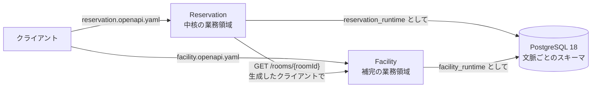
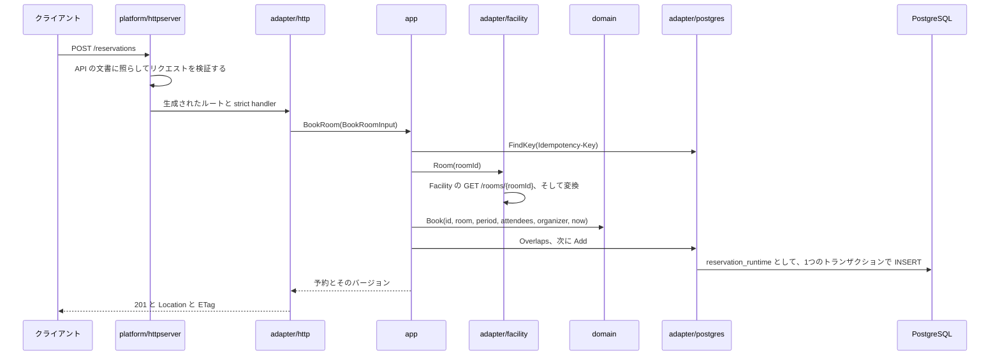

# アーキテクチャ

バックエンドの地図である。区切られた文脈、文脈の中の層、リクエストの流れ、データベース、そして構成を保つチェックを示す。
理由は決定の記録（[docs/adr/](docs/adr/README.ja.md)）に、手順はガイド（[docs/guides/](docs/guides/)）にある。

## 区切られた文脈



| 文脈 | 種類 | 受け持つもの | API の文書 |
|---|---|---|---|
| [Facility](docs/contexts/facility/README.ja.md) | 補完 | 会議室。その名前・定員・利用時間・タイムゾーン | `contracts/http/facility.openapi.yaml` |
| [Reservation](docs/contexts/reservation/README.ja.md) | 中核 | 会議室の予約・変更・取り消し。予約が重ならないようにする | `contracts/http/reservation.openapi.yaml` |

- 各文脈は独立したサービスであり、`backend/cmd/<context>` からビルドする。2つの文脈が共有するコードは `backend/internal/platform/` だけで、データは共有しない。どちらの文脈も、見えるのは自分のスキーマだけである。
- Reservation は、予約のたびに会議室の定員・利用時間・タイムゾーンを必要とする。そこで、Facility の API の文書から oapi-codegen が生成したクライアントを使い、HTTP で Facility に問い合わせる。答えはアダプター `adapter/facility` が Reservation 自身の `domain.Room` に変換するので、Facility の型がユースケースやドメインに届くことはない（TPL-0005）。Facility が失敗したとき、または3秒以内に答えないとき、予約はステータス 503 と `Retry-After` ヘッダーで失敗する。
- Notification と、Reservation が予約を Notification に知らせるための統合イベントは、マイルストーン M2 で加わる。

## 文脈の中の層

業務領域の種類が層を決める（TPL-0003、TPL-0004）。

```text
backend/internal/reservation/    中核：ポートとアダプターを備えたドメインモデル
├── module.go                    アダプター・ユースケース・ハンドラーを組み立てる。import するのは cmd/reservation だけ
└── internal/
    ├── domain/                  集約 Reservation と、その決まり・イベント・業務エラー。I/O をしない
    ├── app/                     ユースケース（1つにつき1ファイル）、ポート、ユースケースのエラー
    └── adapter/
        ├── http/                生成された strict server の操作の実装と、エラーから problem への対応表
        ├── postgres/            schema.sql、queries/、sqlc の生成コード、その上の Store
        └── facility/            Facility の API の文書から生成したクライアントと、その上の RoomDirectory

backend/internal/facility/       補完：トランザクションスクリプト
├── module.go
└── internal/
    ├── app/                     生成したクエリを呼ぶユースケースと、業務エラー
    └── adapter/
        ├── http/
        └── postgres/            schema.sql、queries/、sqlc の生成コード
```

Reservation は、この製品が存在する理由である決まりを持ち、それらの決まりは互いに依存する。
会議室のタイムゾーンによって時間帯がどの日に属するかが決まり、その日によって利用時間が決まる。重なりは、同時に届いた2つのリクエストの間でも起こりうる。
これらの決まりは `domain` に置く。`domain` は現在時刻と新しい ID を引数で受け取るので、決まりのテストは素の関数呼び出しで済む。
`app` のユースケースは、ドメインが必要とするものをポート（`Store`・`RoomDirectory`・`Clock`・`IDGenerator`）を通して読み込む。`module.go` が、そのポートにアダプターをつなぐ。

Facility が確かめる決まりは、会議室が閉まるより前に開くことと、そのタイムゾーンが存在することの2つだけで、あとは行を保存する。
ドメイン層と、ドメイン層と行の間の詰め替えは、これらの決まりより高くつく。そこでユースケースは sqlc が生成した `Querier` を呼び、行を `app` の型へ直接詰め替える。

`lint-arch` は、ディレクトリ `internal/domain/` があるかどうかで2つの種類を見分ける。`app` が自分の `adapter/postgres` を import してよいのは、このディレクトリのない文脈だけである。

## リクエストの流れ

`POST /reservations` は会議室を予約する。



1. `cmd/reservation` は、設定を環境変数から読み（`platform/config`）、接続プールを開く（`platform/postgres`）。そして、`module.go` が組み立てたハンドラーを動かす（`platform/httpserver.Run`）。
2. `platform/httpserver.NewHandler` は、すべてのリクエストをアクセスログと panic からの回復で包み、ヘルスチェック `GET /healthz` には自分で答える。ほかのリクエストはすべて kin-openapi で API の文書に照らして検証する。文書が許さないリクエストには、文脈のコードが動く前に problem で答える。
3. `adapter/http/api.gen.go` の生成コードは、`http.ServeMux` の上でリクエストを振り分け、パラメーターと本文をデコードして生成された型に入れ、`adapter/http/handler.go` の操作を呼ぶ。操作はそれらの型をユースケースの入力に詰め替えるだけで、ほかのことはしない。
4. `app` のユースケース `BookRoom` は、まず冪等キーを調べる。次に、ポート `RoomDirectory` から会議室を、`IDGenerator` から新しい ID を、`Clock` から時刻を得る。最後に、決まりを適用する `domain.Book` を呼ぶ。
5. `adapter/postgres` の `Store` は、sqlc が `queries/*.sql` から生成したクエリで、予約とその冪等キーを1つのトランザクションの中で保存する。その間にほかのリクエストが重なる予約を保存していれば、`schema.sql` の排他制約がこれを拒む。
6. 戻りでは、`adapter/http/problems.go` が `domain` や `app` の業務エラーを対応する problem に変える。それを `platform/httpserver.ResponseError` が `application/problem+json` として書く。そのほかのエラーはログに書かれ、原因を何も明かさない 500 になる。

Facility へのリクエストも同じ流れをたどる。ただし手順4と5は1つになり、ユースケースが生成したクエリを自分で呼ぶ。

## データベース

PostgreSQL 18 の1つのデータベースに、すべての文脈が入る（TPL-0009）。pgschema が管理しないものは `db/bootstrap.sql` が作る。

| 部分 | Facility | Reservation |
|---|---|---|
| スキーマ | `facility` | `reservation` |
| 所有者のロール。スキーマを所有し、pgschema がこのロールで動く | `facility_owner` | `reservation_owner` |
| 実行時のロール。サービスがこのロールで接続する | `facility_runtime` | `reservation_runtime` |
| テーブル（`schema.sql` が作る） | `rooms` | `reservations`、`idempotency_keys` |

- 実行時のロールは自分のスキーマを使え、文脈の `schema.sql` が各テーブルへの `SELECT`・`INSERT`・`UPDATE`・`DELETE` を与える。ほかのスキーマには何の権限もなく、自分のスキーマも変えられない。`public` にオブジェクトを作れるロールもない。
- 文脈の各ロールの検索パスは `<context>, extensions` なので、SQL にスキーマの名前は書かない。Reservation の排他制約が必要とする拡張 `btree_gist` は、スキーマ `extensions` に置く。
- 文脈の `schema.sql` は、そのスキーマのあるべき状態である。pgschema はこれをデータベースに適用し（`make db-apply`）、sqlc はこれを読んでクエリに型を付ける（`make gen`）。tbls は、これから `docs/generated/db/<context>/` を書く（`make gen-db-docs`）。
- 手元では、`compose.yaml` が PostgreSQL を `127.0.0.1:55432` で動かし、`db/local.sql` が各ロールに自分の名前をパスワードとして与える。

## 決まりと、それを守らせるもの

次の決まりはどれも、変更が決まりを破るとチェックが失敗するので守られる。
`make check` はネットワークを使わずに数秒で終わる。`make check-all` は手元の PostgreSQL を要するチェックを加えたもので、CI が実行する。

| 決まり | 守らせるもの | 失敗する場面 |
|---|---|---|
| 文脈は、ほかの文脈のパッケージを import しない（TPL-0005） | Go のコンパイラー（`internal/<context>/internal/` の下のパッケージについて）。`lint-arch` のルール `arch/context-import`（すべてのパッケージとすべてのテストについて） | `make check` |
| `module.go` のパッケージを import するのは `cmd/<context>` だけである（TPL-0005） | `lint-arch` のルール `arch/module-import` | `make check` |
| `platform/` はどの文脈も知らない（TPL-0004） | `lint-arch` のルール `arch/platform-import` | `make check` |
| 依存は内側を向く。`adapter` から `app`、`app` から `domain` へ向かい、アダプターどうしは import し合わない（TPL-0004） | `lint-arch` のルール `arch/layer` | `make check` |
| ドメインは I/O をせず、時計を読まない（TPL-0004） | `lint-arch` のルール `arch/domain-purity`（標準ライブラリのパッケージの許可リスト）と `arch/domain-clock`（`time.Now` などを禁じる） | `make check` |
| API の文書の各操作には、正しい型のハンドラーがある（TPL-0006） | Go のコンパイラー。oapi-codegen が生成する strict server のインターフェースを通して調べる | `make check` |
| 生成コードは、生成器がいまの正から書く内容と同じである（TPL-0007 の層2） | oapi-codegen には `gen-check-api`、sqlc には `gen-check-sqlc` | `make check` |
| API の文書にない HTTP のルートはない（TPL-0007 の層3） | `lint-arch` のルール `arch/route-registration`。ルートを登録できるのは、生成コードと `platform/httpserver` だけである | `make check` |
| API の文書に反するリクエストは、どのハンドラーにも届かない（TPL-0007） | `platform/httpserver` のリクエストの検証（kin-openapi） | 実行時 |
| 各応答は、ステータス・ヘッダー・本文のすべてで API の文書に合う。problem も例外ではない（TPL-0007 の層4） | API のテストのクライアント `platform/apitest`。すべての応答を kin-openapi で検証する | `make check` |
| 業務エラーにはそれぞれ専用の problem があり、problem にはそれぞれ `docs/problems/` のページがある（TPL-0008） | `problems.go` の switch に対するリンター exhaustive と、`problems_test.go` のテスト | `make check` |
| API の文書のエラーの応答は `application/problem+json` である（TPL-0008） | Redocly CLI のルール `rule/problem-details-only`（`lint-contracts`） | `make check` |
| API の文書は、バージョンでそう示さない限り、クライアントとの互換性を壊さない（TPL-0007 の層6） | oasdiff（`lint-contracts-breaking`） | `make check` |
| 文脈は自分のテーブルにだけクエリを出す（TPL-0005、TPL-0009） | 文脈の `schema.sql` だけを読む sqlc。実行時のロールの権限（各文脈の結合テストが試す） | `make check`・実行時・`make check-all` |
| SQL には、ほかの文脈のスキーマの名前も、自分のスキーマの名前も書かない。外部キーで文脈をまたぐと、前者を書くことになる（TPL-0005、TPL-0009） | `lint-arch` のルール `arch/schema-reference` | `make check` |
| 各クエリはスキーマに対して prepare でき、`WHERE` のない `UPDATE` や `DELETE` はない（TPL-0011） | `sqlc vet`（`lint-sqlc`） | `make check-all` |
| スキーマの変更は、使用中のデータベースに対して安全である（TPL-0010） | ベースのコミットからの pgschema の plan に対する squawk（`lint-sql-plan`）。危険な SQL 文が通るのは、`schema-changes.allow` にレビューを経た行があるときだけである | `make check-all` |
| テーブルと列にはすべてコメントがあり、スキーマの文書は最新である（TPL-0023） | tbls（`lint-db-docs`） | `make check-all` |
| 1つの会議室の確定した予約どうしは重ならない（TPL-0009） | 排他制約 `reservations_no_overlap`。Reservation の結合テストが、同時の予約で試す | 実行時・`make check-all` |
| 文脈の用語集は、`domain` パッケージ（ないときは `app`）がエクスポートする型をすべて、英語と日本語の両方で挙げる（TPL-0003） | `lint-arch` のルール `arch/glossary` | `make check` |

次の決まりを守らせるチェックはまだないので、レビューで守る。文脈の業務領域の種類とその README（TPL-0003）と、各主キーの型が `uuid` であること（TPL-0012）である。

<!-- i18n-source: ARCHITECTURE.md sha256:2a8feaf0da5748323fa2f2c002ea6ba161107e5f3ff7806b230e5f547b85f1b9 -->
