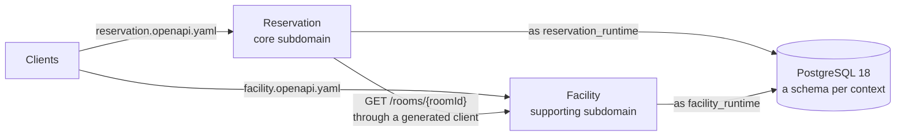
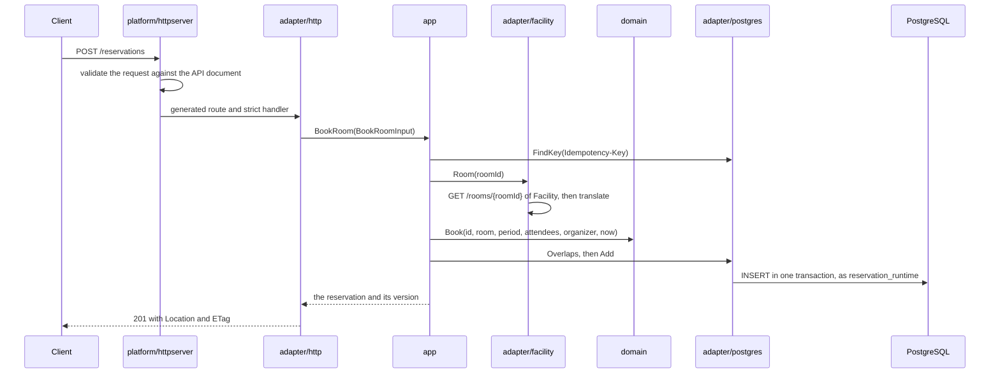

# Architecture

The map of the backend: its bounded contexts, the layers inside each, the path of a request, the database, and the checks that keep the structure in place.
The reasons are in the decision records ([docs/adr/](docs/adr/README.md)), and the procedures in the guides ([docs/guides/](docs/guides/)).

## Bounded contexts



| Context | Kind | Responsible for | API document |
|---|---|---|---|
| [Facility](docs/contexts/facility/README.md) | Supporting | Meeting rooms: their names, capacities, opening hours, and time zones | `contracts/http/facility.openapi.yaml` |
| [Reservation](docs/contexts/reservation/README.md) | Core | Booking, rescheduling, and cancelling a room, without overlaps | `contracts/http/reservation.openapi.yaml` |

- Each context is a service of its own, built from `backend/cmd/<context>`. The two share no code but `backend/internal/platform/`, and no data: each sees only its own schema.
- Reservation needs the capacity, the opening hours, and the time zone of a room for each booking. It asks Facility over HTTP, through a client that oapi-codegen generates from Facility's API document. Its adapter `adapter/facility` translates the answer into Reservation's own `domain.Room`, so no type of Facility reaches its use cases or its domain (TPL-0005). When Facility fails, or does not answer within 3 seconds, the booking fails with status 503 and a `Retry-After` header.
- Notification, and the integration events through which Reservation will tell it about bookings, arrive with milestone M2.

## Layers inside a context

The kind of subdomain decides the layers (TPL-0003, TPL-0004).

```text
backend/internal/reservation/    core: a domain model with ports and adapters
├── module.go                    wires the adapters, the use cases, and the handler; only cmd/reservation imports it
└── internal/
    ├── domain/                  the aggregate Reservation, its rules, events, and business errors; no I/O
    ├── app/                     one file per use case, the ports, and the errors of the use cases
    └── adapter/
        ├── http/                the operations of the generated strict server, and the table from error to problem
        ├── postgres/            schema.sql, queries/, the code that sqlc generates, and Store over it
        └── facility/            the client generated from Facility's API document, and RoomDirectory over it

backend/internal/facility/       supporting: transaction scripts
├── module.go
└── internal/
    ├── app/                     the use cases, which call the generated queries, and the business errors
    └── adapter/
        ├── http/
        └── postgres/            schema.sql, queries/, and the code that sqlc generates
```

Reservation holds the rules that the product exists for, and they depend on each other: the time zone of a room decides on which day a period falls, that day decides the opening hours, and an overlap can arise between two requests that arrive at the same moment.
These rules live in `domain`, which takes the current time and new ids as arguments, so a test of a rule is a plain function call.
The use cases in `app` load what the domain needs through ports (`Store`, `RoomDirectory`, `Clock`, `IDGenerator`), and `module.go` plugs the adapters into them.

Facility checks two rules, that a room opens before it closes and that its time zone exists, and stores rows.
A domain layer, and the mapping between it and the rows, would cost more than these rules, so the use cases call the `Querier` that sqlc generates and map rows to the types of `app` directly.

`lint-arch` tells the two kinds apart by the directory `internal/domain/`: only in a context without it may `app` import its own `adapter/postgres`.

## The path of a request

`POST /reservations` books a room:



1. `cmd/reservation` reads its configuration from the environment (`platform/config`), opens a connection pool (`platform/postgres`), and serves the handler that `module.go` wires (`platform/httpserver.Run`).
2. `platform/httpserver.NewHandler` puts the access log and the recovery from panics around every request, and answers the health check `GET /healthz` itself. It validates every other request against the API document with kin-openapi, and answers a request that the document does not allow with a problem before any code of the context runs.
3. The generated code in `adapter/http/api.gen.go` routes the request on `http.ServeMux`, decodes its parameters and body into generated types, and calls the operation in `adapter/http/handler.go`. The operation maps those types to the input of the use case, and does nothing else.
4. The use case `BookRoom` in `app` looks up the idempotency key, gets the room through the port `RoomDirectory`, a new id from `IDGenerator`, and the time from `Clock`, and calls `domain.Book`, which applies the rules.
5. `Store` in `adapter/postgres` stores the reservation and its idempotency key in one transaction, with the queries that sqlc generated from `queries/*.sql`. The exclusion constraint of `schema.sql` refuses an overlap that another request stored in the meantime.
6. On the way back, `adapter/http/problems.go` turns a business error of `domain` or `app` into its problem, and `platform/httpserver.ResponseError` writes it as `application/problem+json`. Any other error goes to the log and becomes a 500 that says nothing about its cause.

A request to Facility takes the same path, with steps 4 and 5 in one: the use case calls the generated queries itself.

## The database

One PostgreSQL 18 database holds every context (TPL-0009). `db/bootstrap.sql` creates what pgschema does not manage:

| Part | Facility | Reservation |
|---|---|---|
| Schema | `facility` | `reservation` |
| Owner role: owns the schema; pgschema runs as it | `facility_owner` | `reservation_owner` |
| Runtime role: the service connects as it | `facility_runtime` | `reservation_runtime` |
| Tables, from `schema.sql` | `rooms` | `reservations`, `idempotency_keys` |

- The runtime role may use its own schema, and the `schema.sql` of the context grants it `SELECT`, `INSERT`, `UPDATE`, and `DELETE` on each table. It has no privilege in another schema, cannot change its own, and nobody may create objects in `public`.
- Each role of a context has the search path `<context>, extensions`, so no SQL names a schema. The extension `btree_gist`, which the exclusion constraint of Reservation needs, lives in the schema `extensions`.
- The `schema.sql` of a context is its desired state. pgschema applies it to a database (`make db-apply`), sqlc reads it to type the queries (`make gen`), and tbls writes `docs/generated/db/<context>/` from it (`make gen-db-docs`).
- Locally, `compose.yaml` runs PostgreSQL on `127.0.0.1:55432`, and `db/local.sql` gives each role its own name as its password.

## Rules and what enforces them

Each rule below holds because a check fails when a change breaks it.
`make check` runs in seconds without the network; `make check-all` adds the checks that need the local PostgreSQL, and CI runs it.

| Rule | What enforces it | Fails in |
|---|---|---|
| A context imports no package of another context (TPL-0005) | The Go compiler, for the packages under `internal/<context>/internal/`; `lint-arch` rule `arch/context-import`, for every package and every test | `make check` |
| Only `cmd/<context>` imports the package of `module.go` (TPL-0005) | `lint-arch` rule `arch/module-import` | `make check` |
| `platform/` knows no context (TPL-0004) | `lint-arch` rule `arch/platform-import` | `make check` |
| Dependencies point inward, from `adapter` to `app` to `domain`, and adapters do not import each other (TPL-0004) | `lint-arch` rule `arch/layer` | `make check` |
| The domain does no I/O and reads no clock (TPL-0004) | `lint-arch` rules `arch/domain-purity`, an allow-list of standard library packages, and `arch/domain-clock`, against `time.Now` and the like | `make check` |
| Each operation of an API document has a handler with the right types (TPL-0006) | The Go compiler, through the strict server interface that oapi-codegen generates | `make check` |
| Generated code is what the generators write from the sources now (TPL-0007, layer 2) | `gen-check-api` for oapi-codegen, `gen-check-sqlc` for sqlc | `make check` |
| No HTTP route exists outside the API document (TPL-0007, layer 3) | `lint-arch` rule `arch/route-registration`: only generated code and `platform/httpserver` register routes | `make check` |
| A request that breaks the API document reaches no handler (TPL-0007) | The request validation of `platform/httpserver`, with kin-openapi | Run time |
| Each response matches the API document: its status, its headers, and its body, problems included (TPL-0007, layer 4) | `platform/apitest`, the client of the API tests, which validates every response with kin-openapi | `make check` |
| Each business error has a problem of its own, and each problem a page in `docs/problems/` (TPL-0008) | The linter exhaustive on the switches of `problems.go`, and the test in `problems_test.go` | `make check` |
| Error responses in the API documents are `application/problem+json` (TPL-0008) | Redocly CLI, rule `rule/problem-details-only` (`lint-contracts`) | `make check` |
| An API document breaks no client unless its version says so (TPL-0007, layer 6) | oasdiff (`lint-contracts-breaking`) | `make check` |
| A context queries only its own tables (TPL-0005, TPL-0009) | sqlc, which reads only the `schema.sql` of the context; the privileges of the runtime role, which the integration tests of each context try | `make check`, run time, `make check-all` |
| No SQL names the schema of another context, as a foreign key would, or its own (TPL-0005, TPL-0009) | `lint-arch` rule `arch/schema-reference` | `make check` |
| Each query prepares against its schema, and no `UPDATE` or `DELETE` lacks `WHERE` (TPL-0011) | `sqlc vet` (`lint-sqlc`) | `make check-all` |
| A schema change is safe on a database in use (TPL-0010) | squawk on the plan of pgschema from the base commit (`lint-sql-plan`) | `make check-all` |
| Each table and column has a comment, and the schema documents are current (TPL-0023) | tbls (`lint-db-docs`) | `make check-all` |
| Two confirmed reservations of one room never overlap (TPL-0009) | The exclusion constraint `reservations_no_overlap`, tried with concurrent bookings by the integration tests of Reservation | Run time, `make check-all` |
| The glossary of a context lists each exported type of its `domain` package, or of `app` in a context without one, in both languages (TPL-0003) | `lint-arch` rule `arch/glossary` | `make check` |

No check enforces these rules yet, so review does: the kind of subdomain of a context and its README (TPL-0003), and the type `uuid` of each primary key (TPL-0012).
