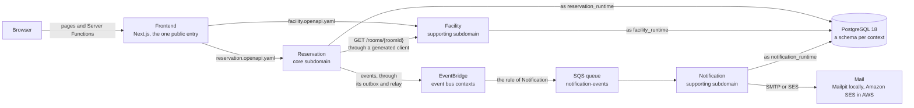
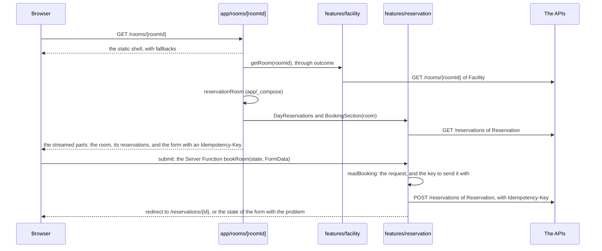
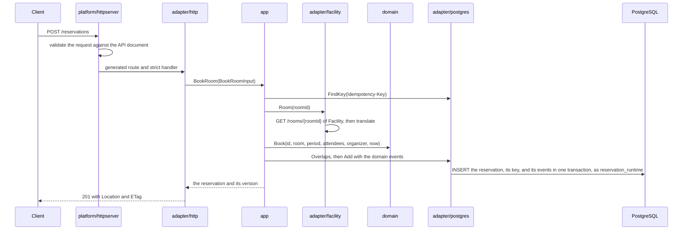
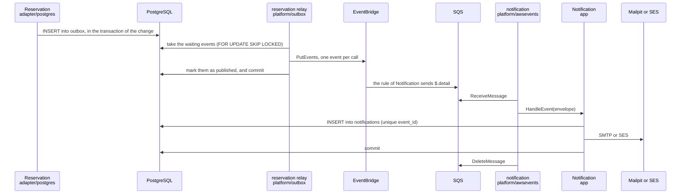
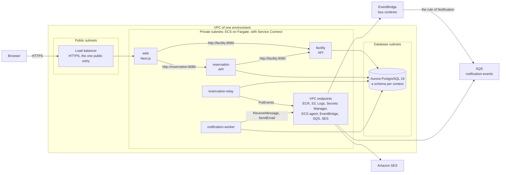

# Architecture

The map of the product: its bounded contexts and their processes, the layers inside each, the frontend that shows them, the path of a request from a screen through an API, the path of an event, the database, the environments in AWS, and the checks that keep the structure in place.
The reasons are in the decision records ([docs/adr/](docs/adr/README.md)), and the procedures in the guides ([docs/guides/](docs/guides/)).

## Bounded contexts



| Context | Kind | Responsible for | Contracts |
|---|---|---|---|
| [Facility](docs/contexts/facility/README.md) | Supporting | Meeting rooms: their names, capacities, opening hours, and time zones | API: `contracts/http/facility.openapi.yaml` |
| [Reservation](docs/contexts/reservation/README.md) | Core | Booking, rescheduling, and cancelling a room, without overlaps | API: `contracts/http/reservation.openapi.yaml`; the events that it publishes: `contracts/events/reservation.asyncapi.yaml` |
| [Notification](docs/contexts/notification/README.md) | Supporting | Mail to the organizer when a reservation is confirmed or cancelled | No API; the events that it consumes: `contracts/events/notification.asyncapi.yaml` |

- Each context is built from `backend/cmd/<context>` into an image of its own. The contexts share no code but `backend/internal/platform/`, and no data: each sees only its own schema.
- Reservation needs the capacity, the opening hours, and the time zone of a room for each booking. It asks Facility over HTTP, through a client that oapi-codegen generates from Facility's API document. Its adapter `adapter/facility` translates the answer into Reservation's own `domain.Room`, so no type of Facility reaches its use cases or its domain (TPL-0005). When Facility fails, or does not answer within 3 seconds, the booking fails with status 503 and a `Retry-After` header.
- Reservation tells Notification about bookings through integration events (TPL-0013), and does not know that Notification exists. [The path of an event](#the-path-of-an-event) follows one from the booking to the mail.
- Notification has no API. It is a worker that reads the events for it from its own queue, and sends mail.
- The frontend, in `frontend/`, is not a context. It shows Facility and Reservation in screens, with one feature for each, and only its server calls their APIs (TPL-0014). [The frontend](#the-frontend) describes it.

## Processes

Each process of a context runs from the image of its context, with the command of the context or one of its modes (TPL-0014). The frontend runs from an image of its own.

| Context | Process | Command | Service in `compose.yaml` | ECS service in AWS |
|---|---|---|---|---|
| Facility | The API | `facility` | `facility` | `facility` |
| Reservation | The API | `reservation` | `reservation` | `reservation` |
| Reservation | The relay of its outbox, a worker | `reservation relay` | `reservation-relay` | `reservation-relay` |
| Notification | The consumer of its queue, a worker | `notification` | `notification` | `notification-worker` |
| (none) | The frontend: the server of Next.js | `frontend/server.js`, the standalone server, on Node | `web` | `web` |

- `platform/httpserver.Main` runs the command of a context, a mode named by its argument (`httpserver.Mode`), or the health check (`<command> healthcheck`). A command reads its configuration from the environment, and the comment at the top of `backend/cmd/<context>/main.go` lists the variables.
- An API runs on `platform/httpserver.Run`. A worker runs on `platform/httpserver.RunWorker`, which serves `GET /healthz` next to the work, so the health check of the image watches an API and a worker the same way. The health check of a worker says only that the process runs: a worker that cannot reach its database or its broker stays healthy, logs the failure, and tries again.
- The relay and the worker read the configuration of the AWS SDK with `platform/awsconfig`: the region, and locally the endpoint of AWS Emulator and its CA (TPL-0017). In AWS, the SDK reaches the services at their usual names, which resolve to the VPC endpoints.
- `frontend/Dockerfile` builds the image of the frontend: the standalone output of `next build` on distroless Node. The server reads the base URL of each API from `FACILITY_API_URL` and `RESERVATION_API_URL`. Its health check, `GET /healthz`, answers 200 and calls no API, so a context that is down does not restart the frontend. Node runs the check (`healthcheck.mjs`), because the image has no shell.

## Layers inside a context

The kind of subdomain decides the layers (TPL-0003, TPL-0004).

```text
backend/internal/reservation/    core: a domain model with ports and adapters
├── module.go                    wires the adapters, the use cases, and the handler, and the relay (NewRelay); only cmd/reservation imports it
└── internal/
    ├── domain/                  the aggregate Reservation, its rules, domain events, and business errors; no I/O
    ├── app/                     one file per use case, the ports, and the errors of the use cases
    └── adapter/
        ├── http/                the operations of the generated strict server, and the table from error to problem
        ├── postgres/            schema.sql, queries/, the code that sqlc generates, Store over it, the mapping from
        │                        domain events to integration events (events.go), and the outbox (outbox.go)
        └── facility/            the client generated from Facility's API document, and RoomDirectory over it

backend/internal/facility/       supporting: transaction scripts
├── module.go
└── internal/
    ├── app/                     the use cases, which call the generated queries, and the business errors
    └── adapter/
        ├── http/
        └── postgres/            schema.sql, queries/, and the code that sqlc generates

backend/internal/notification/   supporting, a worker: a transaction script
├── module.go                    NewHandler returns the event.Handler of the context
└── internal/
    ├── app/                     the use case Notifier, the anticorruption layer for events (events.go), and the port Mailer
    └── adapter/
        ├── postgres/            schema.sql, queries/, and the code that sqlc generates
        ├── smtp/                the Mailer over SMTP, to Mailpit in the local environment
        └── ses/                 the Mailer over Amazon SES, in AWS
```

Reservation holds the rules that the product exists for, and they depend on each other: the time zone of a room decides on which day a period falls, that day decides the opening hours, and an overlap can arise between two requests that arrive at the same moment.
These rules live in `domain`, which takes the current time and new ids as arguments, so a test of a rule is a plain function call.
The use cases in `app` load what the domain needs through ports (`Store`, `RoomDirectory`, `Clock`, `IDGenerator`), and `module.go` plugs the adapters into them.

Facility checks two rules, that a room opens before it closes and that its time zone exists, and stores rows.
A domain layer, and the mapping between it and the rows, would cost more than these rules, so the use cases call the `Querier` that sqlc generates and map rows to the types of `app` directly.

Notification has one rule of its own, that each event sends its mail once, so it is a transaction script like Facility.
Its use case is not called by an operation of an API but by the consumer of its queue, through the `event.Handler` that `NewHandler` returns. It sends its mail through the port `Mailer`, so its tests use a fake in `app/apptest/`. The command picks the adapter from its environment: `adapter/smtp` when `SMTP_ADDR` is set, as in the local system, and `adapter/ses` otherwise, as in AWS.

`lint-arch` tells the two kinds apart by the directory `internal/domain/`: only in a context without it may `app` import its own `adapter/postgres`.

## The frontend

`frontend/` is a Next.js 16 app with the App Router, React 19, and TypeScript 6 (TPL-0002).
The browser talks to it alone. Its server renders the pages, runs the Server Functions of the forms, and calls the APIs of the contexts on the private network, through clients that the API documents type (TPL-0006, TPL-0014). So no API needs CORS, and no address of an API reaches the browser.

```text
frontend/src/
├── app/                         the routes: each page composes features, and wraps what reads live data in <Suspense>
│   ├── page.tsx                 the rooms (Facility)
│   ├── rooms/new/               the form that registers a room (Facility)
│   ├── rooms/[roomId]/          a room (Facility), its reservations on one day, and the form that books it (Reservation)
│   ├── reservations/[reservationId]/
│   │                            a reservation (Reservation) with its room (Facility), and the forms that change it
│   ├── healthz/                 the health check
│   └── _compose/                what one context gives, turned into what another needs: a room of Facility
│                                into the Room of Reservation
├── features/<context>/          one feature per bounded context; a feature never imports another
│   ├── server/                  the calls to the API of the context, through outcome; server-only
│   ├── actions.ts               the Server Functions of the forms
│   ├── <name>.ts                pure logic, such as reading a form and the words for each kind of problem,
│   │                            with its unit tests in <name>.test.ts
│   └── components/              server components, and the forms as client components
└── lib/
    ├── api/                     <context>.gen.ts: the types that openapi-typescript generates from each API document
    ├── api/server/              the clients of the APIs (openapi-fetch), and outcome; server-only
    ├── problem.ts               problems: their kind, and the messages for the fields of a form
    ├── input.ts, zoned-time.ts  the values of a form; dates and times of day in a time zone
    └── components/              Field, ProblemNotice, and useFocusOnProblem
```

- A page is static by default, and each part that reads data of the contexts streams in behind `<Suspense>` (Cache Components). `outcome` waits for the request (`connection()`), so no data of the build reaches a static page.
- Every call to an API becomes a `Result`: the value of the answer, or a problem. An API that does not answer, or that answers with something other than a problem, becomes a problem too, so a screen shows every failure in one way.
- A screen chooses its words by `problemKind`, the name of the page of the problem in `docs/problems/`, and shows the invalid parts of a request at their fields (`fieldErrors`). It never parses a title or a detail (TPL-0008).
- The forms follow the rules of the APIs. A booking sends an Idempotency-Key that the server makes when it renders the form. The form keeps the key with a fingerprint of the booking that went out with it, so the same booking, sent again, books once, and another booking from the same form gets a new key (`features/reservation/booking.ts`). A change sends the version that the page showed in `If-Match`, and nothing goes out without one; on 412, the page shows a notice and the reservation as it is now.
- A person reads and enters times in the time zone of the room, and `lib/zoned-time.ts` converts them to and from the instants of the APIs with `Intl.DateTimeFormat`. It uses no date library, and not `Temporal`, which not every current browser has.
- The CSS is plain, with no component library, and there is no sign-in: the template leaves the design system and the authentication to the team that copies it.

## The path of a request from a screen

The page of a room shows the room and its reservations, and a person books the room with the form on that page:



1. Next.js sends the static shell of the page at once: the layout, the links, and the fallback of each `<Suspense>`. The parts inside render on the server and stream in when their data is there.
2. The page reads the room through the facility feature, turns it into the `Room` of Reservation in `app/_compose/`, and hands it to the components of the reservation feature. The two features never import each other.
3. Each server module calls the API through `outcome`, with the typed client of `lib/api/server/clients.ts` and a timeout of 5 seconds, and gets a `Result`. The base URL of each API comes from the environment.
4. A form posts to its Server Function, which anyone can post to. The function narrows each value of the form, and calls the API. It then goes to the next page (`redirect`), reads the page again (`refresh`), or returns the state that the form shows: the values, a message at each field, and a notice about the whole form.
5. In each API, the request takes the path of the next section.

## The path of a request

In the API of Reservation, `POST /reservations` books a room:



1. `cmd/reservation` reads its configuration from the environment (`platform/config`), opens a connection pool (`platform/postgres`), and serves the handler that `module.go` wires (`platform/httpserver.Run`).
2. `platform/httpserver.NewHandler` puts the access log and the recovery from panics around every request, and answers the health check `GET /healthz` itself. It validates every other request against the API document with kin-openapi, and answers a request that the document does not allow with a problem before any code of the context runs.
3. The generated code in `adapter/http/api.gen.go` routes the request on `http.ServeMux`, decodes its parameters and body into generated types, and calls the operation in `adapter/http/handler.go`. The operation maps those types to the input of the use case, and does nothing else.
4. The use case `BookRoom` in `app` looks up the idempotency key, gets the room through the port `RoomDirectory`, a new id from `IDGenerator`, and the time from `Clock`, and calls `domain.Book`, which applies the rules and returns the reservation and its domain event `ReservationConfirmed`.
5. `Store` in `adapter/postgres` stores the reservation, its idempotency key, and its events in one transaction, with the queries that sqlc generated from `queries/*.sql`. The exclusion constraint of `schema.sql` refuses an overlap that another request stored in the meantime, and then no event is stored either.
6. On the way back, `adapter/http/problems.go` turns a business error of `domain` or `app` into its problem, and `platform/httpserver.ResponseError` writes it as `application/problem+json`. Any other error goes to the log and becomes a 500 that says nothing about its cause.

A request to Facility takes the same path, with steps 4 and 5 in one: the use case calls the generated queries itself.

## The path of an event

The booking of the preceding section reaches the organizer as a mail:



1. The store of Reservation turns each domain event into an integration event (`adapter/postgres/events.go`): a CloudEvents 1.0 envelope (`platform/event`) whose `type` is `reservation.ReservationConfirmed.v1` or `reservation.ReservationCancelled.v1`, whose `source` is `/contexts/reservation`, and whose `data` matches the JSON Schema of the type in `contracts/events/reservation/`. It writes the envelope to the table `outbox` in the transaction of the change. A domain event without an integration event fails the change.
2. The relay is the command `reservation relay`. It runs `platform/outbox.Relay` over the outbox of Reservation (`adapter/postgres.Outbox`), which `NewRelay` in `module.go` builds. Once a second, it takes up to 20 waiting events in the order of their ids with `FOR UPDATE SKIP LOCKED`, so that several relays can run at once. It hands each event to the publisher and marks the published ones in the same transaction. An event that the broker refuses stays in the outbox and comes again with the next look. Published events are deleted after seven days.
3. `platform/awsevents.Publisher` puts each event on the bus `contexts` with `PutEvents`, as an entry whose `source` and `detail-type` are the `source` and the `type` of the envelope, and whose `detail` is the envelope. Before the relay starts, `Publisher.Ready` checks that the bus exists.
4. The rule of Notification, which `infra/modules/event-subscription` creates, selects the two types by `source` and `detail-type`, and sends the `detail` alone, the envelope, to the queue `notification-events`.
5. The worker is the command `notification`. It runs `platform/awsevents.Consumer`, which waits for messages with long polling, reads each body as an envelope, and calls the `event.Handler` of Notification. It deletes a message only after the handler returned nil. Otherwise SQS shows the message again after its visibility timeout, and moves it to `notification-events-dlq` after five receives.
6. The handler, `Notifier.HandleEvent`, reads the data of the event in its anticorruption layer (`internal/app/events.go`) and ignores a type that it does not handle. In one transaction, it records the id of the event in `notifications`, whose unique constraint refuses a second record, sends the mail through the `Mailer`, and commits. A second delivery of the event finds the record and sends nothing.

Delivery is at least once, and events can arrive out of order, so every consumer is idempotent (TPL-0013).
In AWS, the bus and the queue come from the same modules as locally, through the units `platform` and `contexts/notification` ([Infrastructure](#infrastructure)); in the local environment, Terraform applies them to AWS Emulator (`infra/local/`, TPL-0015, TPL-0017).

## The database

One PostgreSQL 18 database holds every context (TPL-0009). `db/bootstrap.sql` creates what pgschema does not manage:

| Part | Facility | Reservation | Notification |
|---|---|---|---|
| Schema | `facility` | `reservation` | `notification` |
| Owner role: owns the schema; pgschema runs as it | `facility_owner` | `reservation_owner` | `notification_owner` |
| Runtime role: the service connects as it | `facility_runtime` | `reservation_runtime` | `notification_runtime` |
| Tables, from `schema.sql` | `rooms` | `reservations`, `idempotency_keys`, `outbox` | `notifications` |

- The runtime role may use its own schema, and the `schema.sql` of the context grants it `SELECT`, `INSERT`, `UPDATE`, and `DELETE` on each table. It has no privilege in another schema, cannot change its own, and nobody may create objects in `public`.
- Each role of a context has the search path `<context>, extensions`, so no SQL names a schema. The extension `btree_gist`, which the exclusion constraint of Reservation needs, lives in the schema `extensions`.
- The `schema.sql` of a context is its desired state. pgschema applies it to a database (`make db-apply`), sqlc reads it to type the queries (`make gen`), and tbls writes `docs/generated/db/<context>/` from it (`make gen-db-docs`).
- Locally, `compose.yaml` runs PostgreSQL on `127.0.0.1:15432`, and `db/local.sql` gives each role its own name as its password. The local system uses the database `app`, and the integration tests a database of their own, `app_test`, on the same server.
- In AWS, the database is Aurora PostgreSQL. Before each deployment, a task runs the image of `db/Dockerfile` as the master user, which is not a superuser: it runs `db/bootstrap.sql`, sets the password of each role from its secret in Secrets Manager, and applies every `schema.sql` (TPL-0016).

## Infrastructure

`infra/` holds the Terraform of the environments in AWS, stg and prd, and of the local environment (TPL-0015).
Nothing has been applied to AWS yet: the modules are tested against a mock of the AWS provider, every unit is validated, and the units of stg are rehearsed on AWS Emulator. [Deploy to AWS](docs/guides/deploy.md) prepares an account, and lists what the first apply must confirm.

### What runs in an account

Each environment is an AWS account of its own, with the same parts:



- Each process of `compose.yaml` runs as an ECS service, from the same image and with the same command: the API of a context is the service `<context>`, and each worker the service `<context>-<worker>` ([Processes](#processes)). The services of a context share one task execution role and one task role, and the task role allows only what the context calls (TPL-0014).
- Only the load balancer of the module `web` can be reached from the internet. The APIs have no load balancer and no public address: a service calls an API through ECS Service Connect at `http://<context>:8080`, the address that it has in Docker Compose (TPL-0014).
- The private subnets have no route to the internet. The tasks reach the AWS services through VPC endpoints, and no security group names an address range outside the VPC (TPL-0014).
- Each service gets `DATABASE_URL` from the secret of its runtime role in Secrets Manager. The cluster is Aurora Serverless v2 from 0 ACU in stg, and two provisioned instances in prd (TPL-0016).
- The unit `platform` creates the event bus, and the unit of Notification its queue, its dead-letter queue, and its rule, with the modules that the local environment applies too (TPL-0013).
- Not drawn: the task that prepares the database before each deployment, the image repositories, the logs in CloudWatch Logs, and the roles of GitHub Actions.

### The units

`infra/live/<environment>/` holds the same units in every environment, and Terragrunt applies each with its own state (TPL-0015).

| Unit | Module | What it creates |
|---|---|---|
| `ci` | `github-oidc` | The roles that GitHub Actions assumes, `github-plan` and `github-deploy` (TPL-0018) |
| `network` | `network` | The VPC, its public, private, and database subnets, and the endpoints of the AWS services |
| `registry` | `registry` | A repository in Amazon ECR for each image: one for each context, `web`, and `db` |
| `database` | `database` | The Aurora cluster, the secrets of the roles of each context, and the task that prepares the database |
| `platform` | `platform` | The ECS cluster, the namespace of Service Connect, the event bus (`event-bus`), and the security group of the services |
| `contexts/<context>` | `context-service` | The services, the roles, the logs, and the subscription (`event-subscription`) of one context |
| `web` | `web` | The service of Next.js, the public load balancer, its certificate, and its DNS record |

- Every `infra/live/<environment>/<unit>/terragrunt.hcl` is the same file. What a unit creates is in `infra/live/_units/<unit>.hcl`, what an environment is in its `env.hcl`, and what all share in `infra/live/system.hcl`, such as the list of contexts.
- `infra/live/root.hcl` gives every unit its state in S3, a provider that accepts only the account of its environment, and the providers of `infra/live/providers.hcl` with the checksums of `providers.lock.hcl`.

### A deployment

The workflow `Deploy` runs `make deploy ENV=stg` after each merge into `main`, then `make deploy ENV=prd` after a reviewer approved the job (TPL-0018). A deployment does four things, in this order (`tools/scripts/infra.sh`):

1. It applies the unit `registry`, then builds and pushes each image whose tag the registry does not hold. The tag is a hash of the files that the image is built from (`tools/scripts/images.sh`).
2. It applies the units `network`, `database`, and `platform`.
3. It runs the task that prepares the database, and waits for it: `db/bootstrap.sql` as the master user, the passwords of the roles, and the `schema.sql` of every context with pgschema (TPL-0010). The schema changes while the old code still runs.
4. It applies every unit. Only the services whose image changed get a new task definition and restart, and ECS rolls back a deployment whose tasks do not become healthy.

On a pull request, the workflow `Plan` runs `make infra-plan` for stg and for prd, as a role that can read and cannot change.

### The local environment

| Path | What it is |
|---|---|
| `infra/modules/event-bus` | The EventBridge bus that carries the integration events of every context |
| `infra/modules/event-subscription` | The subscription of one consuming context: its queue, its dead-letter queue, and the rule that selects its events into the queue |
| `infra/local/` | The root that applies both modules to AWS Emulator: the bus `contexts`, and the subscription of Notification. It accepts only an endpoint on this machine |
| `infra/local/aws-emulator/` | The Dockerfile of the image of AWS Emulator, with the public key that checks its package |

`make up`, `make smoke`, and `make e2e` apply `infra/local/` with `tools/scripts/aws.sh apply` (`make aws-apply`), in the Region `us-east-1` of the emulator. `make rehearse-infra` applies the units of stg to the same emulator, in `ap-northeast-1`, and leaves the local system alone (TPL-0017).

## Rules and what enforces them

Each rule below holds because a check fails when a change breaks it.
`make check` runs in seconds without the network; `make check-all` adds the checks that are slow or need the local PostgreSQL and AWS Emulator, and CI runs it.

| Rule | What enforces it | Fails in |
|---|---|---|
| A context imports no package of another context (TPL-0005) | The Go compiler, for the packages under `internal/<context>/internal/`; `lint-arch` rule `arch/context-import`, for every package and every test | `make check` |
| Only `cmd/<context>` imports the package of `module.go` (TPL-0005) | `lint-arch` rule `arch/module-import` | `make check` |
| `platform/` knows no context (TPL-0004) | `lint-arch` rule `arch/platform-import` | `make check` |
| Dependencies point inward, from `adapter` to `app` to `domain`, and adapters do not import each other (TPL-0004) | `lint-arch` rule `arch/layer` | `make check` |
| The domain does no I/O and reads no clock (TPL-0004) | `lint-arch` rules `arch/domain-purity`, an allow-list of standard library packages, and `arch/domain-clock`, against `time.Now` and the like | `make check` |
| Each operation of an API document has a handler with the right types (TPL-0006) | The Go compiler, through the strict server interface that oapi-codegen generates | `make check` |
| Generated code is what the generators write from the sources now (TPL-0007, layer 2) | `gen-check-api` for oapi-codegen, `gen-check-sqlc` for sqlc, `gen-check-api-ts` for openapi-typescript | `make check` |
| A call of the frontend that the API document does not allow fails, in its path, its parameters, or its body (TPL-0007, layer 1) | The TypeScript compiler, on the types that openapi-fetch takes from the generated `paths` (`lint-frontend-types`) | `make check` |
| No HTTP route exists outside the API document (TPL-0007, layer 3) | `lint-arch` rule `arch/route-registration`: only generated code and `platform/httpserver` register routes | `make check` |
| A request that breaks the API document reaches no handler (TPL-0007) | The request validation of `platform/httpserver`, with kin-openapi | Run time |
| Each response matches the API document: its status, its headers, and its body, problems included (TPL-0007, layer 4) | `platform/apitest`, the client of the API tests, which validates every response with kin-openapi | `make check` |
| Each answer to a request generated from an API document has a status that the operation declares, with the media type, headers, and body that the document gives; no request gets a 5xx, and none that the document allows is refused as unreadable or invalid (TPL-0007, layer 5) | Schemathesis, against the APIs built from the checkout (`test-api-fuzz`) | `make check-all` |
| Each business error has a problem of its own, and each problem a page in `docs/problems/` (TPL-0008) | The linter exhaustive on the switches of `problems.go`, and the test in `problems_test.go` | `make check` |
| Error responses in the API documents are `application/problem+json` (TPL-0008) | Redocly CLI, rule `rule/problem-details-only` (`lint-contracts`) | `make check` |
| An API document breaks no client unless its version says so (TPL-0007, layer 6) | oasdiff (`lint-contracts-breaking`) | `make check` |
| The JSON Schema of each event is well formed, stays open, has examples that match it, and a message of the AsyncAPI document of its context refers to it (TPL-0013) | `lint-events`; Redocly CLI on the AsyncAPI documents (`lint-contracts`) | `make check` |
| A change to the JSON Schema of an event breaks no consumer of its version, and no schema file is deleted (TPL-0013) | `lint-events-breaking` | `make check` |
| Each integration event that a publisher makes matches the JSON Schema of its type (TPL-0013) | `eventtest.AssertMatchesContract` in the tests of the publisher (`adapter/postgres/events_test.go` of Reservation) | `make check` |
| Each domain event has an integration event; none is dropped (TPL-0013) | A test of Reservation that fails when the domain gains a type of event without a sample, and then without a mapping and a contract; the store refuses the change at run time | `make check`, run time |
| A consumer reads every example of the events that it consumes (TPL-0013) | The tests of Notification, which turn every example of the JSON Schemas into a mail (`internal/app/events_test.go`) | `make check` |
| An event is stored if and only if its change commits (TPL-0013) | The outbox is written in the transaction of the change; the integration tests of the store of Reservation | `make check-all` |
| Two relays never publish the same event at once (TPL-0013) | `FOR UPDATE SKIP LOCKED` in the query of the outbox; the integration tests of the outbox, with overlapping drains | `make check-all` |
| A consumer sends each mail once, however often its event is delivered (TPL-0013) | The unique constraint `notifications_event_id_key`; the integration tests of Notification, with a repeated and a concurrent delivery | Run time, `make check-all` |
| A message is deleted from the queue only after its handler took it, and one that keeps failing moves to the dead-letter queue (TPL-0013) | `platform/awsevents.Consumer`; its integration tests against AWS Emulator | `make check-all` |
| An event travels from the outbox through the bus and the queue to the mail (TPL-0013, TPL-0017) | `make smoke`, which waits for the mails of a booking in Mailpit | `make check-all` |
| A context queries only its own tables (TPL-0005, TPL-0009) | sqlc, which reads only the `schema.sql` of the context; the privileges of the runtime role, which the integration tests of each context try | `make check`, run time, `make check-all` |
| No SQL names the schema of another context, as a foreign key would, or its own (TPL-0005, TPL-0009) | `lint-arch` rule `arch/schema-reference` | `make check` |
| Each query prepares against its schema, and no `UPDATE` or `DELETE` lacks `WHERE` (TPL-0011) | `sqlc vet` (`lint-sqlc`) | `make check-all` |
| A schema change is safe on a database in use (TPL-0010) | squawk on the plan of pgschema from the base commit (`lint-sql-plan`); a dangerous statement passes only with a reviewed line in `schema-changes.allow` | `make check-all` |
| Each table and column has a comment, and the schema documents are current (TPL-0023) | tbls (`lint-db-docs`) | `make check-all` |
| Two confirmed reservations of one room never overlap (TPL-0009) | The exclusion constraint `reservations_no_overlap`, tried with concurrent bookings by the integration tests of Reservation | Run time, `make check-all` |
| The glossary of a context lists each exported type of its `domain` package, or of `app` in a context without one, in both languages (TPL-0003) | `lint-arch` rule `arch/glossary` | `make check` |
| The tests of the domain and the use cases of a core context notice each change to their code: no mutant lives, and every line runs in a test, unless a reviewed line of `equivalent-mutants.allow` proves a mutant equivalent (TPL-0003, TPL-0023) | gomutants, on the packages of `MUTATION_PACKAGES` in `make/go.mk` (`test-mutation`) | `make check-all` |
| A feature of the frontend imports no other feature, and `lib` imports no feature (TPL-0003) | ESLint, rule `boundaries/dependencies` of eslint-plugin-boundaries (`lint-frontend`) | `make check` |
| Only the server of Next.js calls the APIs: a module under `server/` imports `server-only`, and no client component imports such a module (TPL-0014) | ESLint, rule `no-restricted-syntax` (`lint-frontend`); `next build`, when a client component imports `server-only` | `make check`, build of the image |
| A link of the frontend leads to a route that exists | The typed routes of Next.js, through the TypeScript compiler (`lint-frontend-types`) | `make check` |
| No page renders data of the contexts at build time | `outcome`, which waits for the request; `next build`, when a page reads uncached data outside `<Suspense>` | Build of the image |
| The pure logic of the frontend does what its tests say: forms, problems, and times in a time zone | Unit tests on the test runner of Node (`test-frontend`) | `make check` |
| A person registers a room, books it, reschedules, and cancels in a browser, and gets the mails; a refused change shows in the words of the screen (TPL-0008, TPL-0017) | `make e2e`: the scenarios of `frontend/e2e/`, with Playwright in Chromium, against the local system | `make check-all` |
| No API of a context can be reached from outside the VPC (TPL-0014) | The tests of `infra/modules/context-service` (`validate-terraform`); Trivy, which accepts a public load balancer in `infra/modules/web/main.tf` alone (`scan-config`, `.trivyignore.yaml`) | `make check`, `make check-all` |
| No task sends to an address range outside the VPC (TPL-0014) | Trivy, check AWS-0104 (`scan-config`); the tests of the modules | `make check`, `make check-all` |
| A deployment restarts only the contexts that changed (TPL-0014) | The tag of each image, a hash of its sources (`tools/scripts/images.sh`); `lint-arch` rule `arch/context-import`, which keeps the sources of a context complete | `make check` |
| stg and prd have the same units, every `terragrunt.hcl` is the same file, every `env.hcl` sets the same keys, and every context has a unit (TPL-0015) | `lint-infra-live` | `make check` |
| Every unit builds and validates, with the outputs of the other units mocked (TPL-0015) | `validate-live` | `make check-all` |
| The units of stg apply to AWS Emulator in the order of a deployment, and those of prd plan against them (TPL-0015, TPL-0017) | `rehearse-infra` | `make check-all` |
| Every unit installs the providers that `infra/live/providers.lock.hcl` names (TPL-0024) | `-lockfile=readonly` in `infra/live/root.hcl` | Every Terragrunt run |
| The image that prepares the database works as a master user that is not a superuser, changes nothing when it runs again, and lets each runtime role read its own schema and no other (TPL-0009, TPL-0016) | `test-db-image`, against the local PostgreSQL | `make check-all` |
| prd changes only through the workflow, after a reviewer approved the job (TPL-0018) | `tools/scripts/infra.sh`, which refuses prd outside GitHub Actions; the GitHub environment `prd` | Run time |
| Each task of the evaluation of the harness fails on the repository as it is, and passes every criterion with its solution, `make check` included (TPL-0020) | The graders, run without an agent (`test-evals`) | `make check-all` |

No check enforces these rules yet, so review does:

- the kind of subdomain of a context and its README (TPL-0003);
- the type `uuid` of each primary key (TPL-0012);
- an AsyncAPI document of each consumer that declares what it consumes (TPL-0013);
- a feature of the frontend that calls the API of its own context only (TPL-0003);
- a screen that never parses the title or the detail of a problem (TPL-0008);
- a public entry in no module but `infra/modules/web` (TPL-0014);
- an entry of `.trivyignore.yaml` that a person approved (TPL-0024);
- a line of `equivalent-mutants.allow` whose proof a person accepted (TPL-0023).
