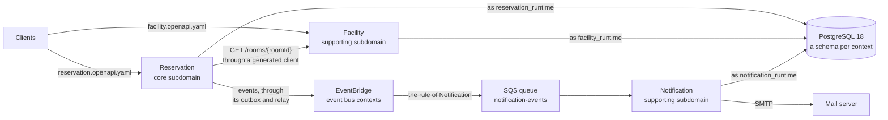
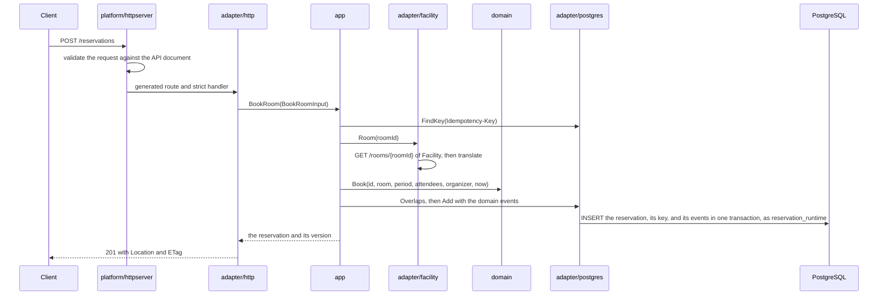
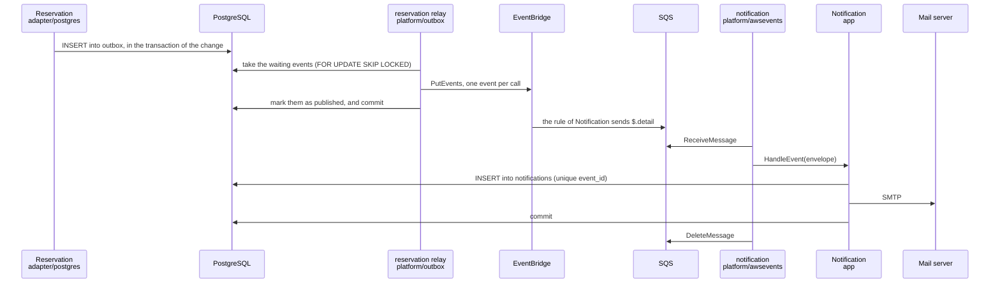

# Architecture

The map of the backend: its bounded contexts and their processes, the layers inside each, the path of a request and of an event, the database, and the checks that keep the structure in place.
The reasons are in the decision records ([docs/adr/](docs/adr/README.md)), and the procedures in the guides ([docs/guides/](docs/guides/)).

## Bounded contexts



| Context | Kind | Responsible for | Contracts |
|---|---|---|---|
| [Facility](docs/contexts/facility/README.md) | Supporting | Meeting rooms: their names, capacities, opening hours, and time zones | API: `contracts/http/facility.openapi.yaml` |
| [Reservation](docs/contexts/reservation/README.md) | Core | Booking, rescheduling, and cancelling a room, without overlaps | API: `contracts/http/reservation.openapi.yaml`; the events that it publishes: `contracts/events/reservation.asyncapi.yaml` |
| [Notification](docs/contexts/notification/README.md) | Supporting | Mail to the organizer when a reservation is confirmed or cancelled | No API; the events that it consumes: `contracts/events/notification.asyncapi.yaml` |

- Each context is built from `backend/cmd/<context>` into an image of its own. The contexts share no code but `backend/internal/platform/`, and no data: each sees only its own schema.
- Reservation needs the capacity, the opening hours, and the time zone of a room for each booking. It asks Facility over HTTP, through a client that oapi-codegen generates from Facility's API document. Its adapter `adapter/facility` translates the answer into Reservation's own `domain.Room`, so no type of Facility reaches its use cases or its domain (TPL-0005). When Facility fails, or does not answer within 3 seconds, the booking fails with status 503 and a `Retry-After` header.
- Reservation tells Notification about bookings through integration events (TPL-0013), and does not know that Notification exists. [The path of an event](#the-path-of-an-event) follows one from the booking to the mail.
- Notification has no API. It is a worker that reads the events for it from its own queue, and sends mail.

## Processes

Each process runs from the image of its context, with the command of the context or one of its modes (TPL-0014).

| Context | Process | Command | Service in `compose.yaml` |
|---|---|---|---|
| Facility | The API | `facility` | `facility` |
| Reservation | The API | `reservation` | `reservation` |
| Reservation | The relay of its outbox, a worker | `reservation relay` | `reservation-relay` |
| Notification | The consumer of its queue, a worker | `notification` | `notification` |

- `platform/httpserver.Main` runs the command of a context, a mode named by its argument (`httpserver.Mode`), or the health check (`<command> healthcheck`). A command reads its configuration from the environment, and the comment at the top of `backend/cmd/<context>/main.go` lists the variables.
- An API runs on `platform/httpserver.Run`. A worker runs on `platform/httpserver.RunWorker`, which serves `GET /healthz` next to the work, so the health check of the image watches an API and a worker the same way. The health check of a worker says only that the process runs: a worker that cannot reach its database or its broker stays healthy, logs the failure, and tries again.
- The relay and the worker read the configuration of the AWS SDK with `platform/awsconfig`: the region, and locally the endpoint of AWS Emulator and its CA (TPL-0017).

## Layers inside a context

The kind of subdomain decides the layers (TPL-0003, TPL-0004).

```text
backend/internal/reservation/    core: a domain model with ports and adapters
├── module.go                    wires the adapters, the use cases, and the handler, and the relay (NewRelay); only cmd/reservation imports it
└── internal/
    ├── domain/                  the aggregate Reservation, its rules, domain events, and business errors; no I/O
    ├── app/                     one file per use case, the ports, and the errors of the use cases
    └── adapter/
        ├── http/                the operations of the generated strict server, and the table from error to problem
        ├── postgres/            schema.sql, queries/, the code that sqlc generates, Store over it, the mapping from
        │                        domain events to integration events (events.go), and the outbox (outbox.go)
        └── facility/            the client generated from Facility's API document, and RoomDirectory over it

backend/internal/facility/       supporting: transaction scripts
├── module.go
└── internal/
    ├── app/                     the use cases, which call the generated queries, and the business errors
    └── adapter/
        ├── http/
        └── postgres/            schema.sql, queries/, and the code that sqlc generates

backend/internal/notification/   supporting, a worker: a transaction script
├── module.go                    NewHandler returns the event.Handler of the context
└── internal/
    ├── app/                     the use case Notifier, the anticorruption layer for events (events.go), and the port Mailer
    └── adapter/
        ├── postgres/            schema.sql, queries/, and the code that sqlc generates
        └── smtp/                the Mailer over SMTP
```

Reservation holds the rules that the product exists for, and they depend on each other: the time zone of a room decides on which day a period falls, that day decides the opening hours, and an overlap can arise between two requests that arrive at the same moment.
These rules live in `domain`, which takes the current time and new ids as arguments, so a test of a rule is a plain function call.
The use cases in `app` load what the domain needs through ports (`Store`, `RoomDirectory`, `Clock`, `IDGenerator`), and `module.go` plugs the adapters into them.

Facility checks two rules, that a room opens before it closes and that its time zone exists, and stores rows.
A domain layer, and the mapping between it and the rows, would cost more than these rules, so the use cases call the `Querier` that sqlc generates and map rows to the types of `app` directly.

Notification has one rule of its own, that each event sends its mail once, so it is a transaction script like Facility.
Its use case is not called by an operation of an API but by the consumer of its queue, through the `event.Handler` that `NewHandler` returns. It reaches the mail server through the port `Mailer`, so its tests use a fake in `app/apptest/`.

`lint-arch` tells the two kinds apart by the directory `internal/domain/`: only in a context without it may `app` import its own `adapter/postgres`.

## The path of a request

`POST /reservations` books a room:



1. `cmd/reservation` reads its configuration from the environment (`platform/config`), opens a connection pool (`platform/postgres`), and serves the handler that `module.go` wires (`platform/httpserver.Run`).
2. `platform/httpserver.NewHandler` puts the access log and the recovery from panics around every request, and answers the health check `GET /healthz` itself. It validates every other request against the API document with kin-openapi, and answers a request that the document does not allow with a problem before any code of the context runs.
3. The generated code in `adapter/http/api.gen.go` routes the request on `http.ServeMux`, decodes its parameters and body into generated types, and calls the operation in `adapter/http/handler.go`. The operation maps those types to the input of the use case, and does nothing else.
4. The use case `BookRoom` in `app` looks up the idempotency key, gets the room through the port `RoomDirectory`, a new id from `IDGenerator`, and the time from `Clock`, and calls `domain.Book`, which applies the rules and returns the reservation and its domain event `ReservationConfirmed`.
5. `Store` in `adapter/postgres` stores the reservation, its idempotency key, and its events in one transaction, with the queries that sqlc generated from `queries/*.sql`. The exclusion constraint of `schema.sql` refuses an overlap that another request stored in the meantime, and then no event is stored either.
6. On the way back, `adapter/http/problems.go` turns a business error of `domain` or `app` into its problem, and `platform/httpserver.ResponseError` writes it as `application/problem+json`. Any other error goes to the log and becomes a 500 that says nothing about its cause.

A request to Facility takes the same path, with steps 4 and 5 in one: the use case calls the generated queries itself.

## The path of an event

The booking of the preceding section reaches the organizer as a mail:



1. The store of Reservation turns each domain event into an integration event (`adapter/postgres/events.go`): a CloudEvents 1.0 envelope (`platform/event`) whose `type` is `reservation.ReservationConfirmed.v1` or `reservation.ReservationCancelled.v1`, whose `source` is `/contexts/reservation`, and whose `data` matches the JSON Schema of the type in `contracts/events/reservation/`. It writes the envelope to the table `outbox` in the transaction of the change. A domain event without an integration event fails the change.
2. The relay is the command `reservation relay`. It runs `platform/outbox.Relay` over the outbox of Reservation (`adapter/postgres.Outbox`), which `NewRelay` in `module.go` builds. Once a second, it takes up to 20 waiting events in the order of their ids with `FOR UPDATE SKIP LOCKED`, so that several relays can run at once. It hands each event to the publisher and marks the published ones in the same transaction. An event that the broker refuses stays in the outbox and comes again with the next look. Published events are deleted after seven days.
3. `platform/awsevents.Publisher` puts each event on the bus `contexts` with `PutEvents`, as an entry whose `source` and `detail-type` are the `source` and the `type` of the envelope, and whose `detail` is the envelope. Before the relay starts, `Publisher.Ready` checks that the bus exists.
4. The rule of Notification, which `infra/modules/event-subscription` creates, selects the two types by `source` and `detail-type`, and sends the `detail` alone, the envelope, to the queue `notification-events`.
5. The worker is the command `notification`. It runs `platform/awsevents.Consumer`, which waits for messages with long polling, reads each body as an envelope, and calls the `event.Handler` of Notification. It deletes a message only after the handler returned nil. Otherwise SQS shows the message again after its visibility timeout, and moves it to `notification-events-dlq` after five receives.
6. The handler, `Notifier.HandleEvent`, reads the data of the event in its anticorruption layer (`internal/app/events.go`) and ignores a type that it does not handle. In one transaction, it records the id of the event in `notifications`, whose unique constraint refuses a second record, sends the mail through the `Mailer`, and commits. A second delivery of the event finds the record and sends nothing.

Delivery is at least once, and events can arrive out of order, so every consumer is idempotent (TPL-0013).
In AWS, the bus and the queue will come from the same modules as locally; in the local environment, Terraform applies them to AWS Emulator (`infra/local/`, TPL-0015, TPL-0017).

## The database

One PostgreSQL 18 database holds every context (TPL-0009). `db/bootstrap.sql` creates what pgschema does not manage:

| Part | Facility | Reservation | Notification |
|---|---|---|---|
| Schema | `facility` | `reservation` | `notification` |
| Owner role: owns the schema; pgschema runs as it | `facility_owner` | `reservation_owner` | `notification_owner` |
| Runtime role: the service connects as it | `facility_runtime` | `reservation_runtime` | `notification_runtime` |
| Tables, from `schema.sql` | `rooms` | `reservations`, `idempotency_keys`, `outbox` | `notifications` |

- The runtime role may use its own schema, and the `schema.sql` of the context grants it `SELECT`, `INSERT`, `UPDATE`, and `DELETE` on each table. It has no privilege in another schema, cannot change its own, and nobody may create objects in `public`.
- Each role of a context has the search path `<context>, extensions`, so no SQL names a schema. The extension `btree_gist`, which the exclusion constraint of Reservation needs, lives in the schema `extensions`.
- The `schema.sql` of a context is its desired state. pgschema applies it to a database (`make db-apply`), sqlc reads it to type the queries (`make gen`), and tbls writes `docs/generated/db/<context>/` from it (`make gen-db-docs`).
- Locally, `compose.yaml` runs PostgreSQL on `127.0.0.1:15432`, and `db/local.sql` gives each role its own name as its password. The local system uses the database `app`, and the integration tests a database of their own, `app_test`, on the same server.

## Infrastructure

`infra/` holds the Terraform that creates the AWS resources of the events (TPL-0015).

| Path | What it is |
|---|---|
| `infra/modules/event-bus` | The EventBridge bus that carries the integration events of every context |
| `infra/modules/event-subscription` | The subscription of one consuming context: its queue, its dead-letter queue, and the rule that selects its events into the queue |
| `infra/local/` | The root that applies both modules to AWS Emulator: the bus `contexts`, and the subscription of Notification. It accepts only an endpoint on this machine |
| `infra/local/aws-emulator/` | The Dockerfile of the image of AWS Emulator, with the public key that checks its package |

`make up` and `make smoke` apply `infra/local/` with `tools/scripts/aws.sh apply` (`make aws-apply`). The other modules and the Terragrunt units for stg and prd arrive with the infrastructure milestone.

## Rules and what enforces them

Each rule below holds because a check fails when a change breaks it.
`make check` runs in seconds without the network; `make check-all` adds the checks that need the local PostgreSQL and AWS Emulator, and CI runs it.

| Rule | What enforces it | Fails in |
|---|---|---|
| A context imports no package of another context (TPL-0005) | The Go compiler, for the packages under `internal/<context>/internal/`; `lint-arch` rule `arch/context-import`, for every package and every test | `make check` |
| Only `cmd/<context>` imports the package of `module.go` (TPL-0005) | `lint-arch` rule `arch/module-import` | `make check` |
| `platform/` knows no context (TPL-0004) | `lint-arch` rule `arch/platform-import` | `make check` |
| Dependencies point inward, from `adapter` to `app` to `domain`, and adapters do not import each other (TPL-0004) | `lint-arch` rule `arch/layer` | `make check` |
| The domain does no I/O and reads no clock (TPL-0004) | `lint-arch` rules `arch/domain-purity`, an allow-list of standard library packages, and `arch/domain-clock`, against `time.Now` and the like | `make check` |
| Each operation of an API document has a handler with the right types (TPL-0006) | The Go compiler, through the strict server interface that oapi-codegen generates | `make check` |
| Generated code is what the generators write from the sources now (TPL-0007, layer 2) | `gen-check-api` for oapi-codegen, `gen-check-sqlc` for sqlc | `make check` |
| No HTTP route exists outside the API document (TPL-0007, layer 3) | `lint-arch` rule `arch/route-registration`: only generated code and `platform/httpserver` register routes | `make check` |
| A request that breaks the API document reaches no handler (TPL-0007) | The request validation of `platform/httpserver`, with kin-openapi | Run time |
| Each response matches the API document: its status, its headers, and its body, problems included (TPL-0007, layer 4) | `platform/apitest`, the client of the API tests, which validates every response with kin-openapi | `make check` |
| Each business error has a problem of its own, and each problem a page in `docs/problems/` (TPL-0008) | The linter exhaustive on the switches of `problems.go`, and the test in `problems_test.go` | `make check` |
| Error responses in the API documents are `application/problem+json` (TPL-0008) | Redocly CLI, rule `rule/problem-details-only` (`lint-contracts`) | `make check` |
| An API document breaks no client unless its version says so (TPL-0007, layer 6) | oasdiff (`lint-contracts-breaking`) | `make check` |
| The JSON Schema of each event is well formed, stays open, has examples that match it, and a message of the AsyncAPI document of its context refers to it (TPL-0013) | `lint-events`; Redocly CLI on the AsyncAPI documents (`lint-contracts`) | `make check` |
| A change to the JSON Schema of an event breaks no consumer of its version, and no schema file is deleted (TPL-0013) | `lint-events-breaking` | `make check` |
| Each integration event that a publisher makes matches the JSON Schema of its type (TPL-0013) | `eventtest.AssertMatchesContract` in the tests of the publisher (`adapter/postgres/events_test.go` of Reservation) | `make check` |
| Each domain event has an integration event; none is dropped (TPL-0013) | A test of Reservation that fails when the domain gains a type of event without a sample, and then without a mapping and a contract; the store refuses the change at run time | `make check`, run time |
| A consumer reads every example of the events that it consumes (TPL-0013) | The tests of Notification, which turn every example of the JSON Schemas into a mail (`internal/app/events_test.go`) | `make check` |
| An event is stored if and only if its change commits (TPL-0013) | The outbox is written in the transaction of the change; the integration tests of the store of Reservation | `make check-all` |
| Two relays never publish the same event at once (TPL-0013) | `FOR UPDATE SKIP LOCKED` in the query of the outbox; the integration tests of the outbox, with overlapping drains | `make check-all` |
| A consumer sends each mail once, however often its event is delivered (TPL-0013) | The unique constraint `notifications_event_id_key`; the integration tests of Notification, with a repeated and a concurrent delivery | Run time, `make check-all` |
| A message is deleted from the queue only after its handler took it, and one that keeps failing moves to the dead-letter queue (TPL-0013) | `platform/awsevents.Consumer`; its integration tests against AWS Emulator | `make check-all` |
| An event travels from the outbox through the bus and the queue to the mail (TPL-0013, TPL-0017) | `make smoke`, which waits for the mails of a booking in Mailpit | `make check-all` |
| A context queries only its own tables (TPL-0005, TPL-0009) | sqlc, which reads only the `schema.sql` of the context; the privileges of the runtime role, which the integration tests of each context try | `make check`, run time, `make check-all` |
| No SQL names the schema of another context, as a foreign key would, or its own (TPL-0005, TPL-0009) | `lint-arch` rule `arch/schema-reference` | `make check` |
| Each query prepares against its schema, and no `UPDATE` or `DELETE` lacks `WHERE` (TPL-0011) | `sqlc vet` (`lint-sqlc`) | `make check-all` |
| A schema change is safe on a database in use (TPL-0010) | squawk on the plan of pgschema from the base commit (`lint-sql-plan`); a dangerous statement passes only with a reviewed line in `schema-changes.allow` | `make check-all` |
| Each table and column has a comment, and the schema documents are current (TPL-0023) | tbls (`lint-db-docs`) | `make check-all` |
| Two confirmed reservations of one room never overlap (TPL-0009) | The exclusion constraint `reservations_no_overlap`, tried with concurrent bookings by the integration tests of Reservation | Run time, `make check-all` |
| The glossary of a context lists each exported type of its `domain` package, or of `app` in a context without one, in both languages (TPL-0003) | `lint-arch` rule `arch/glossary` | `make check` |

No check enforces these rules yet, so review does: the kind of subdomain of a context and its README (TPL-0003), the type `uuid` of each primary key (TPL-0012), and an AsyncAPI document of each consumer that declares what it consumes (TPL-0013).
