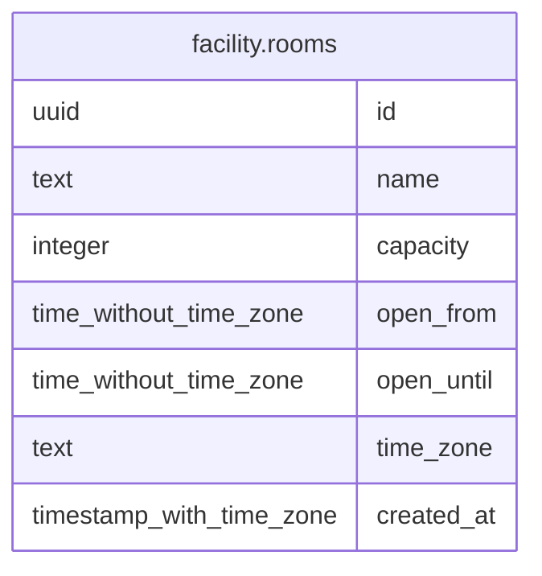

# facility

## Tables

| Name | Columns | Comment | Type |
| ---- | ------- | ------- | ---- |
| [facility.rooms](facility.rooms.md) | 7 | Meeting rooms that can be booked. | BASE TABLE |

## Relations

---

> Generated by [tbls](https://github.com/k1LoW/tbls)
