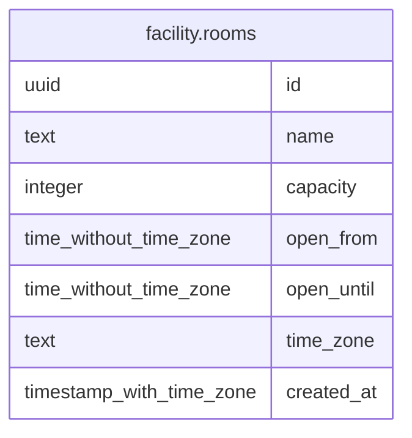

# facility.rooms

## Description

Meeting rooms that can be booked.

## Columns

| Name | Type | Default | Nullable | Children | Parents | Comment |
| ---- | ---- | ------- | -------- | -------- | ------- | ------- |
| id | uuid | uuidv7() | false |  |  | The id of the room, a UUID version 7. |
| name | text |  | false |  |  | The name that people use for the room. Unique. |
| capacity | integer |  | false |  |  | The largest number of people the room holds. |
| open_from | time without time zone |  | false |  |  | The time of day from which the room can be used, in time_zone. |
| open_until | time without time zone |  | false |  |  | The time of day until which the room can be used, in time_zone. |
| time_zone | text |  | false |  |  | The IANA time zone in which open_from and open_until are read. |
| created_at | timestamp with time zone |  | false |  |  | When the room was registered. |

## Constraints

| Name | Type | Definition |
| ---- | ---- | ---------- |
| rooms_capacity_check | CHECK | CHECK (((capacity >= 1) AND (capacity <= 1000))) |
| rooms_capacity_not_null | n | NOT NULL capacity |
| rooms_created_at_not_null | n | NOT NULL created_at |
| rooms_id_not_null | n | NOT NULL id |
| rooms_name_not_null | n | NOT NULL name |
| rooms_open_from_not_null | n | NOT NULL open_from |
| rooms_open_hours_check | CHECK | CHECK ((open_from < open_until)) |
| rooms_open_until_not_null | n | NOT NULL open_until |
| rooms_time_zone_not_null | n | NOT NULL time_zone |
| rooms_pkey | PRIMARY KEY | PRIMARY KEY (id) |
| rooms_name_key | UNIQUE | UNIQUE (name) |

## Indexes

| Name | Definition |
| ---- | ---------- |
| rooms_pkey | CREATE UNIQUE INDEX rooms_pkey ON facility.rooms USING btree (id) |
| rooms_name_key | CREATE UNIQUE INDEX rooms_name_key ON facility.rooms USING btree (name) |

## Relations

---

> Generated by [tbls](https://github.com/k1LoW/tbls)
