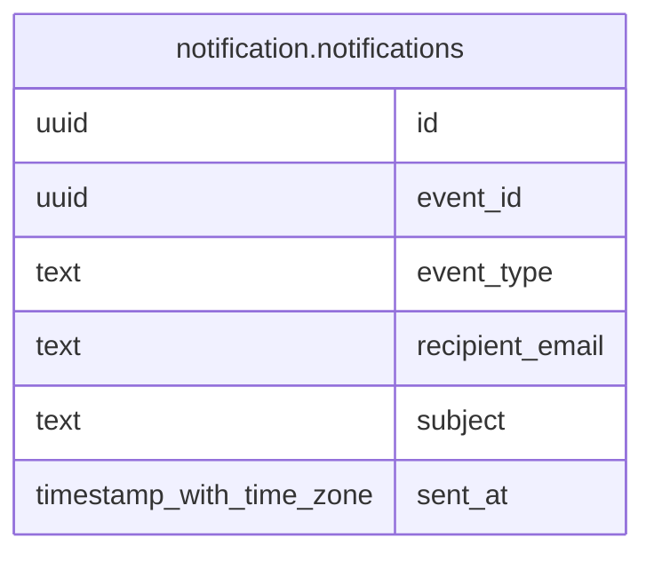

# notification

## Tables

| Name | Columns | Comment | Type |
| ---- | ------- | ------- | ---- |
| [notification.notifications](notification.notifications.md) | 6 | The mails that Notification sent, one for each event that it handled. | BASE TABLE |

## Relations

---

> Generated by [tbls](https://github.com/k1LoW/tbls)
