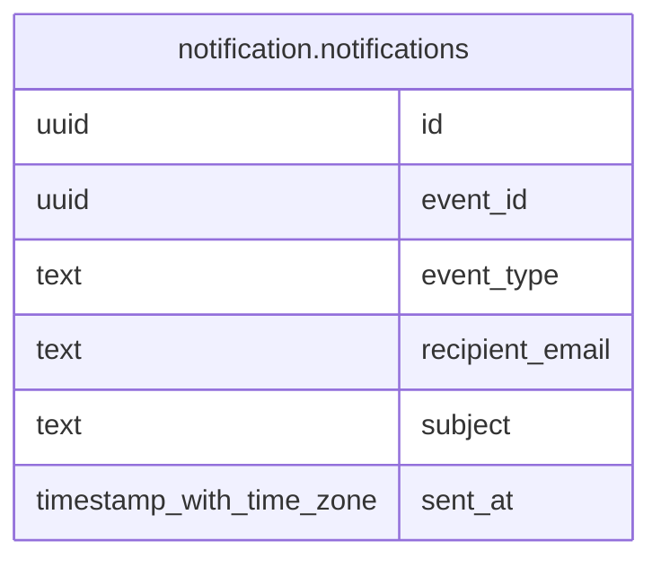

# notification.notifications

## Description

The mails that Notification sent, one for each event that it handled.

## Columns

| Name | Type | Default | Nullable | Children | Parents | Comment |
| ---- | ---- | ------- | -------- | -------- | ------- | ------- |
| id | uuid | uuidv7() | false |  |  | The id of the notification, a UUID version 7. |
| event_id | uuid |  | false |  |  | The id of the event that the mail reports. Unique, so an event that comes again sends no second mail. |
| event_type | text |  | false |  |  | The type of that event, such as reservation.ReservationConfirmed.v1. |
| recipient_email | text |  | false |  |  | The address that the mail went to. |
| subject | text |  | false |  |  | The subject of the mail. |
| sent_at | timestamp with time zone |  | false |  |  | When Notification sent the mail: the time just before it handed the mail to the mail server. |

## Constraints

| Name | Type | Definition |
| ---- | ---- | ---------- |
| notifications_event_id_not_null | n | NOT NULL event_id |
| notifications_event_type_not_null | n | NOT NULL event_type |
| notifications_id_not_null | n | NOT NULL id |
| notifications_recipient_email_not_null | n | NOT NULL recipient_email |
| notifications_sent_at_not_null | n | NOT NULL sent_at |
| notifications_subject_not_null | n | NOT NULL subject |
| notifications_pkey | PRIMARY KEY | PRIMARY KEY (id) |
| notifications_event_id_key | UNIQUE | UNIQUE (event_id) |

## Indexes

| Name | Definition |
| ---- | ---------- |
| notifications_pkey | CREATE UNIQUE INDEX notifications_pkey ON notification.notifications USING btree (id) |
| notifications_event_id_key | CREATE UNIQUE INDEX notifications_event_id_key ON notification.notifications USING btree (event_id) |

## Relations

---

> Generated by [tbls](https://github.com/k1LoW/tbls)
