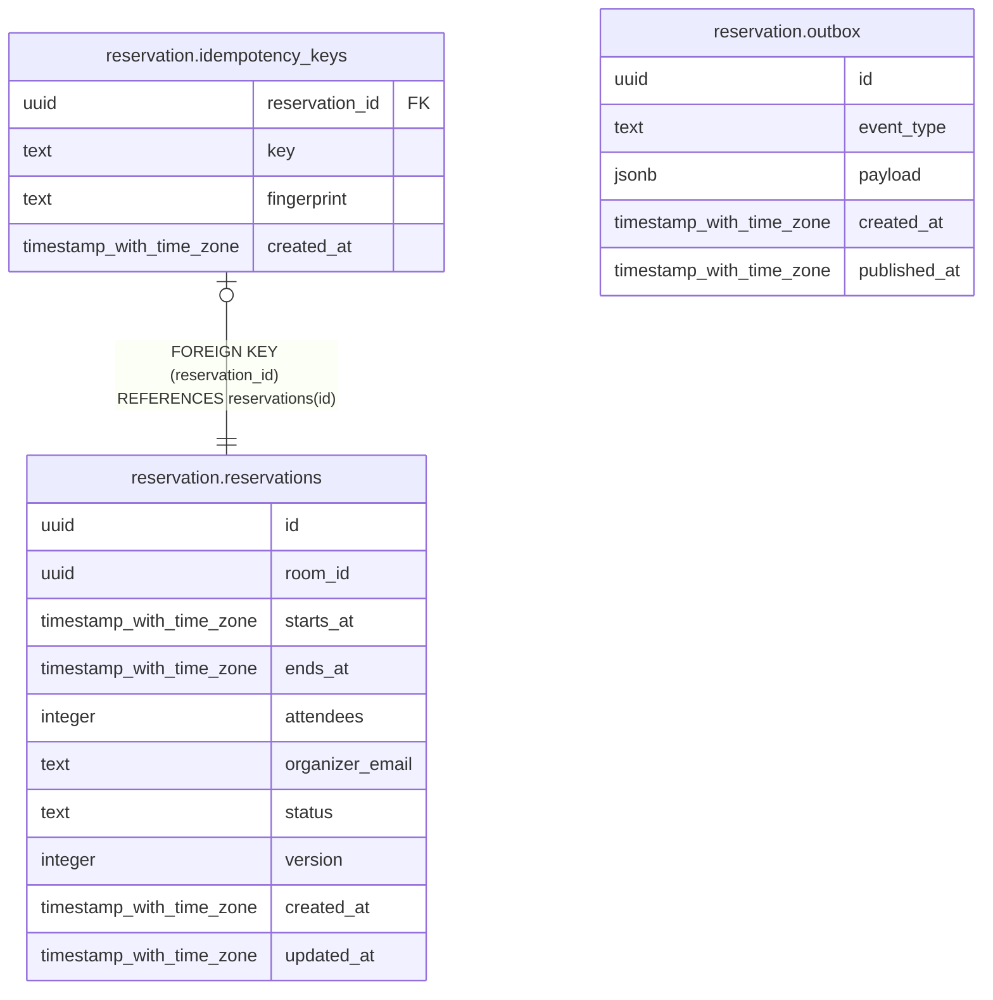

# reservation

## Tables

| Name | Columns | Comment | Type |
| ---- | ------- | ------- | ---- |
| [reservation.outbox](reservation.outbox.md) | 5 | The integration events of Reservation, stored with the change that they report, until the relay has published them and some time after (TPL-0013). | BASE TABLE |
| [reservation.reservations](reservation.reservations.md) | 10 | Reservations of meeting rooms, confirmed and cancelled. | BASE TABLE |
| [reservation.idempotency_keys](reservation.idempotency_keys.md) | 4 | The Idempotency-Key of each booking, so that a repeated request books nothing new. | BASE TABLE |

## Relations

---

> Generated by [tbls](https://github.com/k1LoW/tbls)
