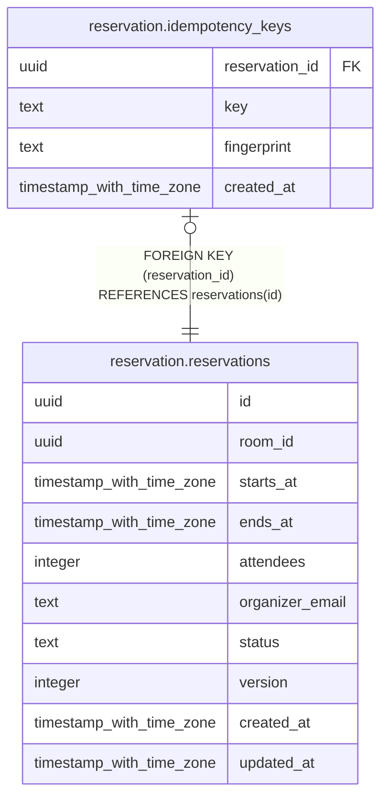

# reservation.idempotency_keys

## Description

The Idempotency-Key of each booking, so that a repeated request books nothing new.

## Columns

| Name | Type | Default | Nullable | Children | Parents | Comment |
| ---- | ---- | ------- | -------- | -------- | ------- | ------- |
| reservation_id | uuid |  | false |  | [reservation.reservations](reservation.reservations.md) | The reservation that the request booked. It is the primary key: one key per booking. |
| key | text |  | false |  |  | The key that the client sent. Unique. |
| fingerprint | text |  | false |  |  | The SHA-256 of the content of the request, to tell a repeat from another request with the same key. |
| created_at | timestamp with time zone |  | false |  |  | When the key was stored. |

## Constraints

| Name | Type | Definition |
| ---- | ---- | ---------- |
| idempotency_keys_created_at_not_null | n | NOT NULL created_at |
| idempotency_keys_fingerprint_not_null | n | NOT NULL fingerprint |
| idempotency_keys_key_not_null | n | NOT NULL key |
| idempotency_keys_reservation_id_not_null | n | NOT NULL reservation_id |
| idempotency_keys_reservation_id_fkey | FOREIGN KEY | FOREIGN KEY (reservation_id) REFERENCES reservations(id) |
| idempotency_keys_pkey | PRIMARY KEY | PRIMARY KEY (reservation_id) |
| idempotency_keys_key_key | UNIQUE | UNIQUE (key) |

## Indexes

| Name | Definition |
| ---- | ---------- |
| idempotency_keys_pkey | CREATE UNIQUE INDEX idempotency_keys_pkey ON reservation.idempotency_keys USING btree (reservation_id) |
| idempotency_keys_key_key | CREATE UNIQUE INDEX idempotency_keys_key_key ON reservation.idempotency_keys USING btree (key) |

## Relations

---

> Generated by [tbls](https://github.com/k1LoW/tbls)
