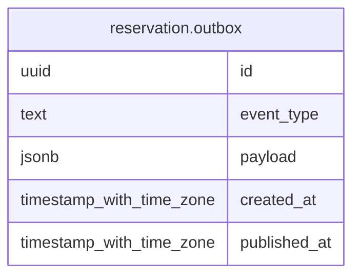

# reservation.outbox

## Description

The integration events of Reservation, stored with the change that they report, until the relay has published them and some time after (TPL-0013).

## Columns

| Name | Type | Default | Nullable | Children | Parents | Comment |
| ---- | ---- | ------- | -------- | -------- | ------- | ------- |
| id | uuid | uuidv7() | false |  |  | The id of the event, a UUID version 7, as in its envelope. The relay publishes the events in the order of their id. |
| event_type | text |  | false |  |  | The CloudEvents type of the event, such as reservation.ReservationConfirmed.v1, for people who read the table. |
| payload | jsonb |  | false |  |  | The whole CloudEvents envelope of the event, as the relay publishes it. |
| created_at | timestamp with time zone |  | false |  |  | When the change that the event reports was stored. |
| published_at | timestamp with time zone |  | true |  |  | When the relay published the event. Null while the event waits. |

## Constraints

| Name | Type | Definition |
| ---- | ---- | ---------- |
| outbox_created_at_not_null | n | NOT NULL created_at |
| outbox_event_type_not_null | n | NOT NULL event_type |
| outbox_id_not_null | n | NOT NULL id |
| outbox_payload_not_null | n | NOT NULL payload |
| outbox_pkey | PRIMARY KEY | PRIMARY KEY (id) |

## Indexes

| Name | Definition |
| ---- | ---------- |
| outbox_pkey | CREATE UNIQUE INDEX outbox_pkey ON reservation.outbox USING btree (id) |
| outbox_published_at_idx | CREATE INDEX outbox_published_at_idx ON reservation.outbox USING btree (published_at) WHERE (published_at IS NOT NULL) |
| outbox_unpublished_id_idx | CREATE INDEX outbox_unpublished_id_idx ON reservation.outbox USING btree (id) WHERE (published_at IS NULL) |

## Relations

---

> Generated by [tbls](https://github.com/k1LoW/tbls)
