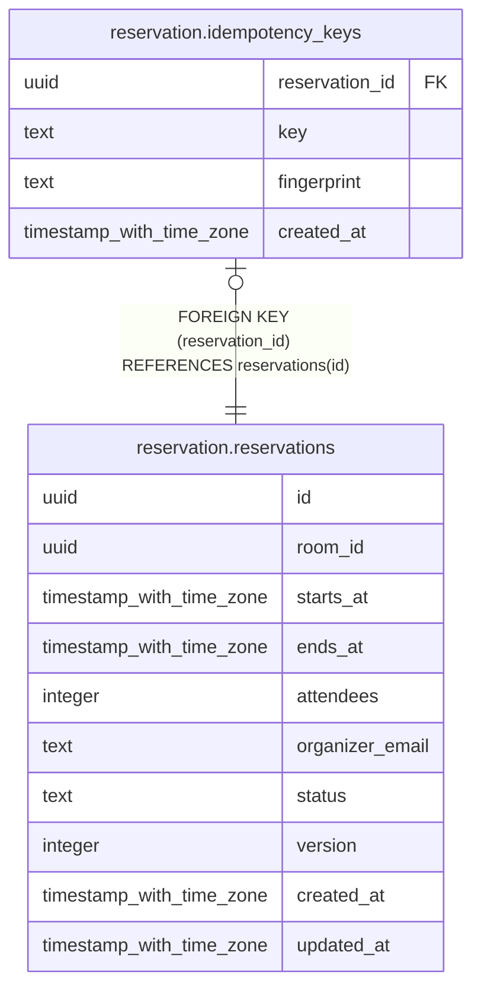

# reservation.reservations

## Description

Reservations of meeting rooms, confirmed and cancelled.

## Columns

| Name | Type | Default | Nullable | Children | Parents | Comment |
| ---- | ---- | ------- | -------- | -------- | ------- | ------- |
| id | uuid | uuidv7() | false | [reservation.idempotency_keys](reservation.idempotency_keys.md) |  | The id of the reservation, a UUID version 7. |
| room_id | uuid |  | false |  |  | The id of the room in the Facility context. No foreign key: the room lives in another context (TPL-0005). |
| starts_at | timestamp with time zone |  | false |  |  | When the reservation starts. The period includes this instant. |
| ends_at | timestamp with time zone |  | false |  |  | When the reservation ends. The period excludes this instant. |
| attendees | integer |  | false |  |  | How many people attend, the organizer included. |
| organizer_email | text |  | false |  |  | The email address of the person who booked the room. |
| status | text |  | false |  |  | confirmed while the reservation holds the room, cancelled after it was cancelled. |
| version | integer | 1 | false |  |  | Counts the changes of the reservation, from 1. A change names the version it read (optimistic locking). |
| created_at | timestamp with time zone |  | false |  |  | When the room was booked. |
| updated_at | timestamp with time zone |  | false |  |  | When the reservation last changed. |

## Constraints

| Name | Type | Definition |
| ---- | ---- | ---------- |
| reservations_attendees_check | CHECK | CHECK ((attendees >= 1)) |
| reservations_attendees_not_null | n | NOT NULL attendees |
| reservations_created_at_not_null | n | NOT NULL created_at |
| reservations_ends_at_not_null | n | NOT NULL ends_at |
| reservations_id_not_null | n | NOT NULL id |
| reservations_organizer_email_not_null | n | NOT NULL organizer_email |
| reservations_period_check | CHECK | CHECK ((starts_at < ends_at)) |
| reservations_room_id_not_null | n | NOT NULL room_id |
| reservations_starts_at_not_null | n | NOT NULL starts_at |
| reservations_status_check | CHECK | CHECK ((status = ANY (ARRAY['confirmed'::text, 'cancelled'::text]))) |
| reservations_status_not_null | n | NOT NULL status |
| reservations_updated_at_not_null | n | NOT NULL updated_at |
| reservations_version_check | CHECK | CHECK ((version >= 1)) |
| reservations_version_not_null | n | NOT NULL version |
| reservations_pkey | PRIMARY KEY | PRIMARY KEY (id) |
| reservations_no_overlap | x | EXCLUDE USING gist (room_id WITH =, tstzrange(starts_at, ends_at, '[)'::text) WITH &&) WHERE ((status = 'confirmed'::text)) |

## Indexes

| Name | Definition |
| ---- | ---------- |
| reservations_pkey | CREATE UNIQUE INDEX reservations_pkey ON reservation.reservations USING btree (id) |
| reservations_no_overlap | CREATE INDEX reservations_no_overlap ON reservation.reservations USING gist (room_id, tstzrange(starts_at, ends_at, '[)'::text)) WHERE (status = 'confirmed'::text) |
| reservations_starts_at_id_idx | CREATE INDEX reservations_starts_at_id_idx ON reservation.reservations USING btree (starts_at, id) |

## Relations

---

> Generated by [tbls](https://github.com/k1LoW/tbls)
